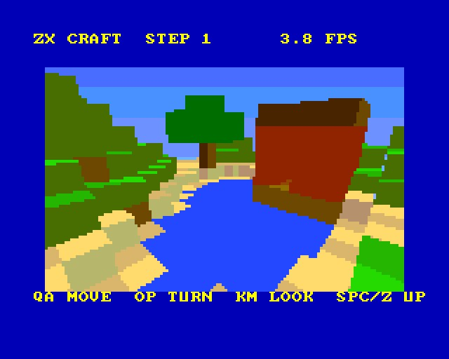
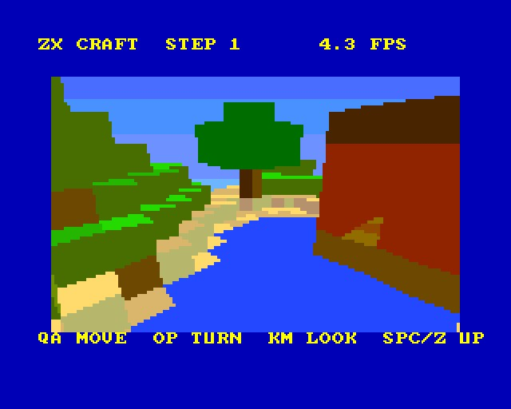
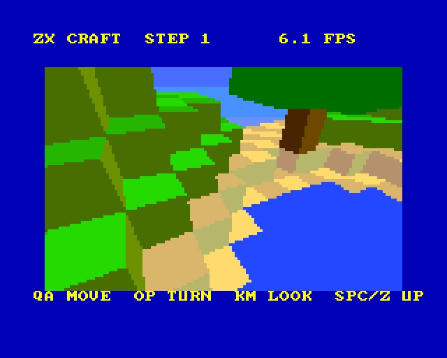
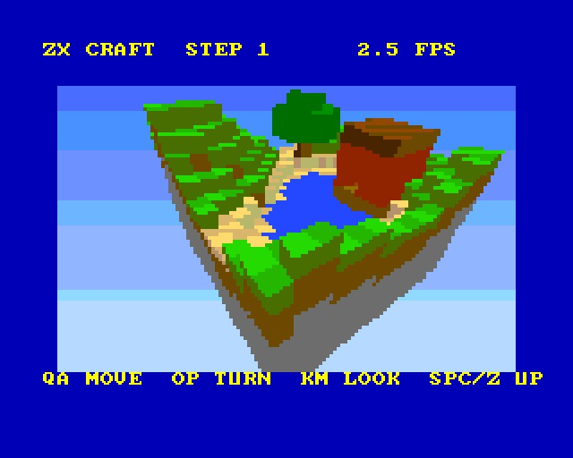
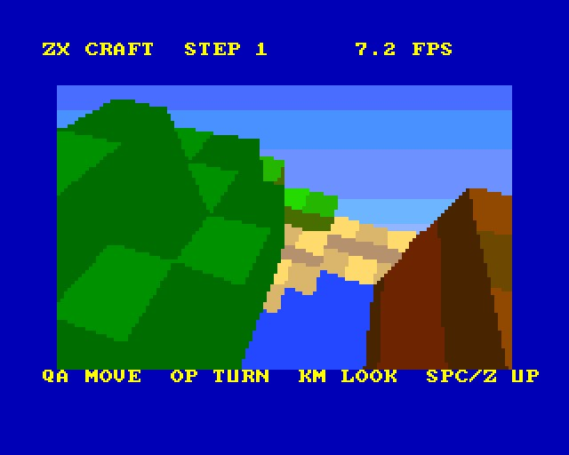

# ZX CRAFT - step 1: the renderer

(c) 2026 Cyborg Unicorn Pty Ltd - MIT License

The first step of ZX Craft for the **ZX Spectrum Next**, in **NTC BASIC** (VB5 flavour) with the
drawing in Z80: a block world drawn with filled faces, Starstrike II style, on Layer 2. This step
is only the renderer and one fixed 16 x 16 x 16 chunk (hills, a lake, sand, a tree, a brick hut),
so the speed can be measured before anything else is built on it. You can fly round the chunk.

## Keys

| | |
|---|---|
| Q A | forward, back |
| O P | turn left, right |
| K M | look up, down |
| Space, Z | up, down |

Left alone at the start, it turns slowly on the spot. Any key stops that. The frames a second
show top right.

## How it draws a frame

- **Camera:** the camera's basis comes from yaw and pitch. Three small tables then hold every grid
  line along right, up and forward, so a block corner in camera space is three adds.
- **Groups:** the chunk is 64 groups of 4 x 4 x 4 blocks.
  - A group outside the view is skipped. A group on the edge of the view has its blocks tested
    one at a time.
  - Groups, and the blocks in each group, are taken nearest first by Manhattan distance
    (|dx| + |dy| + |dz| from the camera's block). That distance only goes up along any line of
    sight, so this is a true front-to-back order, with no sorting of faces.
- **Faces:**
  - Only a block's faces next to air are listed, by `Build`.
  - Of those, only the ones facing the camera are drawn.
  - Each corner is projected once a frame. The projection is a reciprocal table plus the Next's
    `MUL D,E`, kept in a cache of 2048 corners.
  - A face cut by the near plane, or too far off to the side, goes a slower way: it is cut in 3D,
    projected in 16 bits, dropped if it is off the screen, then cut to a guard band.
- **No overdraw:** each screen row keeps a list of what is already drawn this frame. A face's span
  only fills the parts that are still empty, so every pixel is written once and the screen is
  never cleared. What is left over at the end is the sky.
- **Screen:**
  - 128 x 80 pixels of 2 x 2 on Layer 2 (rows 16-175), filled with `PUSH`.
  - Two buffers, flipped at the frame's end.
  - Text above and below is NTC's own tilemap text.

## Speed

Measured in an emulated Next at 28MHz. The emulator uses plain Z80 timings with no memory wait
states, and this hasn't been run on real hardware yet.

| What's in view | Frames a second |
|---|---|
| The whole chunk from outside, sides and all | 2.5 - 3.5 |
| Standing in it, most of the chunk in front | 4 - 7 |
| Closer views, part of the chunk | 10 - 20 |

The cost is spread over the whole pipeline, per block and per face. In the worst view (all
1007 open blocks, 488 faces drawn), no part takes more than about a fifth of the time:
- filling polygons and their edges
- projecting corners
- the row lists
- walking the blocks
- the pixel writes themselves

Every frame matched the Python model (`tools/ref.py`) pixel for pixel over a scripted flight of
395 frames.

## Files

- `Main.bas`: the test program (keys, camera, frames a second).
- `Vox.cls`: the renderer. It is made by `tools/gen_vox.py`; all its drawing is in the `#asm`
  blocks of `Render`.
- `World.cls`: the chunk (run-length data) and the colours, made by `tools/world.py`.
- `Nx.cls`: NextRegs and the border.
- `tools/`:
  - `gen_vox.py`: writes `Vox.cls`. With `-d` it adds counters for testing.
  - `ref.py`: the same renderer in Python, step for step the same integer sums. Use it to try
    changes, and to check the Z80's pictures.
  - `world.py`: the chunk, the block colours and the sky. Writes `World.cls`.
  - `vx_math.asm`: multiply and divide.
- `build.js`, `game.json`, `ZXCRAFT.json` (the IDE project).
- `build/`: `ZXCRAFT.asm` and `ZXCRAFT.NEX`, ready to run.
- `screenshots/`.

## Building it

- **IDE:** open `ZXCRAFT.json` in NTC BASIC's IDE (`ntc.html`), then **Save .asm** and run
  `sjasmplus ZXCRAFT.asm`.
- **Command line:** `node build.js path/to/ntc/src` remakes the project, the `.asm` and the
  `.NEX` (when sjasmplus is on the PATH).
- **Running it:** copy `ZXCRAFT.NEX` to the SD card and run it from the browser.

## Changing the world and the colours

The blocks' colours are not tiles. Each block type has 8 Layer 2 colours (RRRGGGBB):
- one for each side
- one for the bottom
- two for the top (it is checkered so the grid shows)
- one spare

There are also 80 sky colours, one a row. All of them are in `tools/world.py`, along with the
chunk's generator (`make()`). Edit them and run `python3 tools/world.py`. It rewrites
`World.cls` and leaves the game alone.

Blocks: 0 air, 1 grass, 2 dirt, 3 stone, 4 sand, 5 water, 6 wood, 7 leaves, 8 brick.

A chunk is 4096 bytes in `x + 16 z + 256 y` order (y up), run-length coded in pairs: a count
(0 means 256), then the block. This is the form the chunk server will send in step 3.

## Memory

- **Program and arrays:** `#0040` to about `#87E0` (RAM pages 16-21), with the stack at `#BE00`.
- **Layer 2:** banks 16-18 and 19-21. While drawing, one 8K page at a time goes in slot 6.
- **Corner cache:** RAM page 44, in slot 7 only while drawing. The tilemap's page goes back after,
  and the display reads bank 5 whatever is in the slot.
- **Text:** NTC's tilemap in bank 5.

## Found in NTC (worked around, not changed)

NTC's text setup in `ntc_plat_zxn.asm` writes the register number as the value into NextReg #15
and #68. `#15` set to `#15` puts the ULA and tilemap on top of Layer 2, so Layer 2 can't be seen.
`Vox.Screen` sets #15 back to 0 after the first `Print`.

## Next steps

1. **Speed:**
   - per group, the faces' facing and the block order worked out once rather than per block
   - a quad-only fill path
   - fewer corner projections for far groups
2. **Space mode:** Starstrike II style filled ships, on this fill and row-list code.
3. **The chunk server:** PHP, with world generation, sending this run-length form. The Next
   fetches chunks through its ESP8266 (UART at #133B / #143B).
4. **Editing:** placing and digging blocks (rebuilding one group's face list), then other
   players.

## Screenshots

Taken in an emulated Next:

