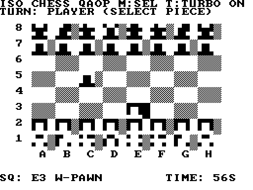

# ISOChess - NTC BASIC: Amstrad CPC, ZX Spectrum Next, Sinclair ZX81

One `ISOChess.bas` for all of them (`#If NTC_ZXN` / `#If NTC_ZX81` branches). `node build.js
path/to/ntc/src` builds every platform into its folder; `cpc/`, `cpcmin/`, `cpcfw/`
(`ISOCHESS.BIN`, `RUN"ISOCHESS`), `zxn/` (`ISOCHESS.NEX`, with `Nx.cls`), `zx81/`
(`ISOCHESS.P`, with `Zx.cls`: Open Tape in EightyOne, ZX81 16K).

## The ZX81 version

No bitmap on a ZX81, so the board is top down: 8 x 8 tiles of 3 x 2 cells, dark squares
grey, the pieces 2 x 2 cell icons made of the quarter block characters (4 x 4 chunky pixels
each: pawn, rook, knight, bishop, queen, king). The ZX81 prints black on white, so the
player's white pieces are the inverse video ones (white on black) and the CPU's are black.
Each tile's third column carries the cursor (a full block), a `+` on a valid empty target or
a `*` on a capturable piece.

Keys: Q / A / O / P move the cursor (up / down / left / right), M selects, T toggles turbo.

The ZX81 has no video hardware: the program draws every picture itself (each `Frame`), so
while the CPU searches the screen is blank - FAST mode - and comes back with its move (about
2-3 seconds at the start of a game). That is turbo on, the default. T turns it off: the search
draws a frame every few moves it tries, so the board stays up (flickering) and the search
takes longer. The turn clock counts frames (50 a second), so it runs while the player is
thinking and stands still while the CPU is.

The same game logic as the CPC/Next version; only the drawing (`RenderTile`, from the board
state - no XOR, no isometric projection) and the keys differ. 11K, fits a 16K ZX81. Tested in NTC's ZX81 model; not
yet on real hardware.
