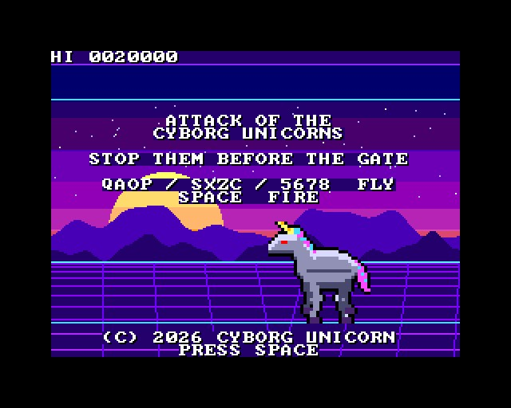
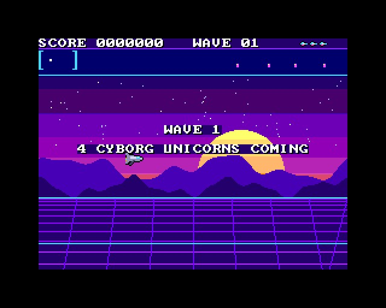
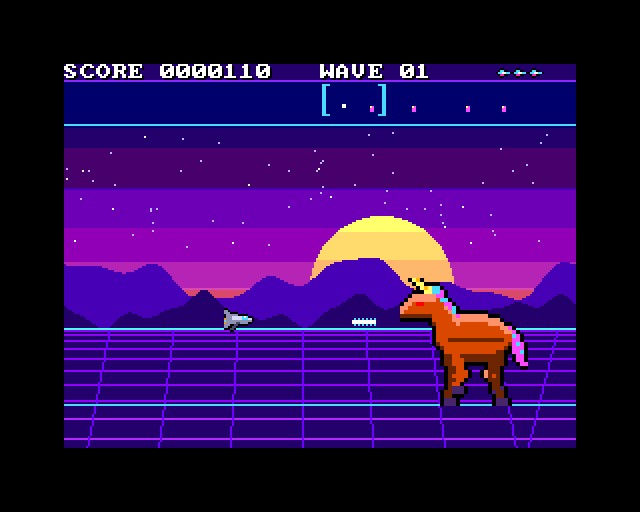
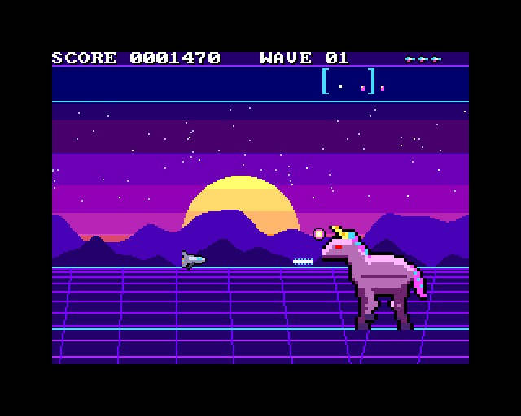
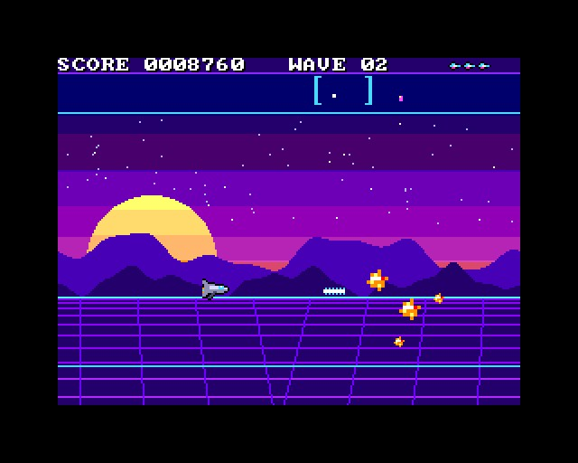
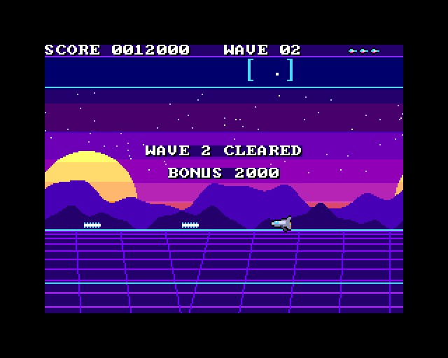
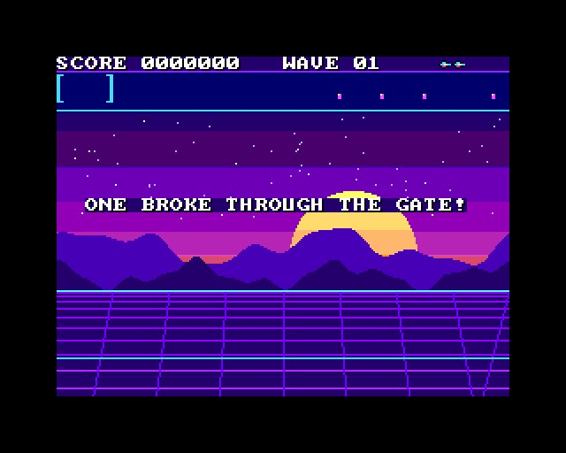

# ATTACK OF THE CYBORG UNICORNS

(c) 2026 Cyborg Unicorn Pty Ltd - MIT License

A side-scrolling shooter in the style of Jeff Minter's *Attack of the Mutant Camels*, for the
**ZX Spectrum Next**, written in **NTC BASIC**. The art and names are original.

Giant cyborg unicorns are marching across the neon plain towards the gate at its far left end.
You fly a jet over them and shoot them down.
- Each unicorn takes a lot of shooting. It goes from silver to pink to orange to red as it
  breaks up.
- They fire bolts from their horns at you. From wave 3 they fire three at a time.
- If one walks through the gate, you lose a ship and it starts again from the far end.
- Clear a wave and a bigger, faster, angrier one comes. Waves go on until your ships are gone.

## Keys

| | |
|---|---|
| Q A O P, or S X Z C, or the cursor keys 5 6 7 8 | fly |
| Space, M (or Kempston fire) | fire (hold it down) |

Left and right turn the jet that way and speed it up. It keeps its speed (and slows down
gently) when you let go. The view runs ahead of the jet the way it's facing.

## The screen

- **The plain:** 2048 pixels long (8 screens). The gate is at the left end.
- **The scanner** (under the score) shows the whole plain at 1 in 8:
  - you (white)
  - every unicorn (pink)
  - the part on screen (the bracket).
- **Lives:** the ships at the top right.

## Scoring

- **Each hit:** 10.
- **Each unicorn:** 500 x the wave.
- **Each wave cleared:** 1000 x the wave.

## Waves

| | Wave 1 | Each wave after |
|---|---|---|
| Unicorns | 4 | one more, 7 at most |
| Hits to bring one down | 20 | 4 more |
| Walking speed | slow | faster, every second wave |
| Horn bolts | single, slow | faster and more often; three at a time from wave 3 |

## How it uses the hardware

- **Layer 2:** the landscape, one 256 x 192 picture (bank 16) that joins up end to end.
  - The hardware scroll (NextReg #16) moves it with the view, so it costs nothing a frame.
  - It's packed in runs in `Scene.cls` (3K) and unpacked once at the start.
- **Sprites:**
  - The jet.
  - The unicorns: 2 x 2 cells of 16 x 16 each, drawn twice the size, so 64 x 64 on screen.
    They have 4 walking steps, and 4 palettes for the damage plus a hit flash.
  - The explosions and the scanner's dots.
  - The sprite clip window (with NextReg #15 bit 5) cuts them to the paper.
- **Bolts and shots:** `Bul.cls`, the bullet engine from DANMAKU, changed for this game. Shots fly
  sideways and everything moves with the scrolling ground. 60 bolts and 18 shots are moved and
  checked, and their sprites built, in Z80 each frame.
- **Tilemap:** the score line and the scanner, plus the messages. It sits over Layer 2, and the
  sprites sit over it (layer order SUL).
- **AY:** shots, hits, horn bolts, explosions, the wave bonus.
- **Frame rate:** 50 frames a second, logic and all. That was measured in the emulator over
  waves 1-4 in a scripted run; it hasn't been run on real hardware yet.

## Files

- `Main.bas`: the game.
- `Scene.cls`: the landscape. Made by `tools/scene.py`; edit that and run `python3 tools/scene.py`.
- `Bul.cls`: the bolts and shots.
- `GfxData.cls`: the tiles and sprites. Made from `gfx/` by `gfxtool.js`; edit the PNGs and
  `layout.txt`, then rebuild.
- `Nx.cls`, `Spr.cls`, `Tiles.cls`, `Sfx.cls`: NextRegs, sprites, the tilemap, AY sound.
- `build.js`, `game.json`, `AOTCU.json` (the IDE project).
- `build/`: `AOTCU.asm` and `AOTCU.NEX`, ready to run.

## Building it

- **IDE:** open `AOTCU.json` in NTC BASIC's IDE (`ntc.html`), then **Save .asm** and run
  `sjasmplus AOTCU.asm`.
- **Command line:** `node build.js path/to/ntc/src` rebuilds the art, the project, the `.asm` and
  the `.NEX` (when sjasmplus is on the PATH).
- **Running it:** copy `AOTCU.NEX` to the SD card and run it from the browser.

## Screenshots

Taken in an emulated Next:

