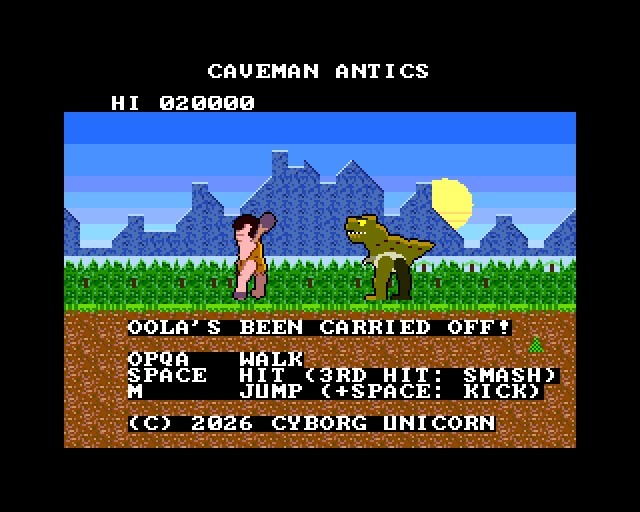
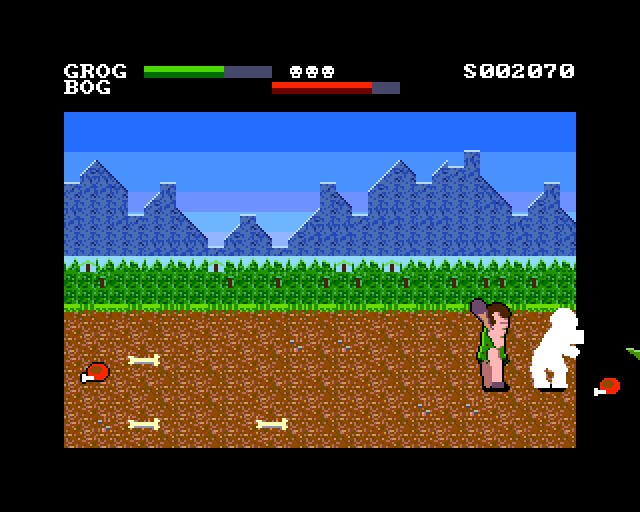
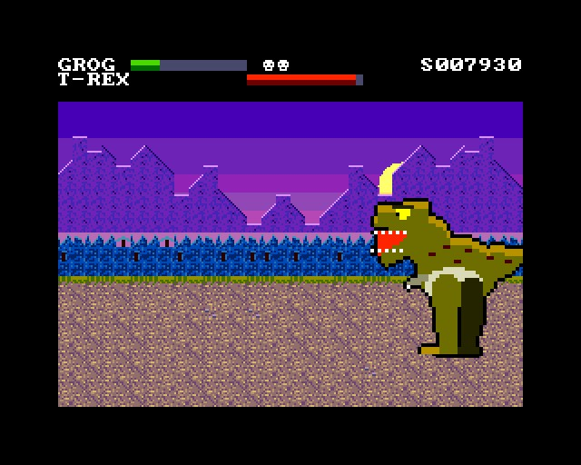
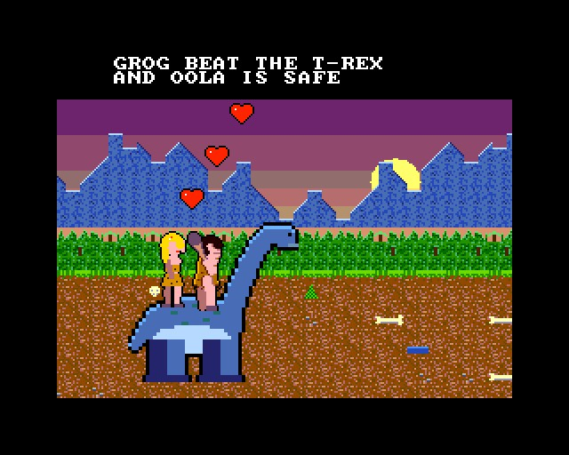

# CAVEMAN ANTICS

(c) 2026 Cyborg Unicorn Pty Ltd - MIT License

A scrolling beat 'em up in the style of Final Fight, for the **ZX Spectrum Next**, written in
**NTC BASIC**. It's cavemen and dinosaurs.

Oola's been carried off. Grog follows her, club in hand, through five lands, fighting rival
cavemen, raptors and pterodactyls all the way. Each land has a big one at the end. Beat the T-rex,
find Oola, and ride home on Bronty the brontosaurus.

## How it plays

- **The lands:** each one is six stretches. The screen stops at each stretch until everyone in
  it is beaten, then an arrow says go on. The big one waits at the end.

  | Stage | Land | Big one |
  |---|---|---|
  | 1 | The jungle | Big Bog |
  | 2 | The tar pits | the Triceratops (it charges) |
  | 3 | The volcano | the Ptero Queen (she drops rocks) |
  | 4 | The ice caves | King Thud (he calls for help) |
  | 5 | T-rex valley | the T-rex |

- **Fighting:** hit, hit, then the third hit brings the club down, which knocks them flat. A
  flying kick (jump, then hit) knocks them down too.
- **Moving:** you can walk into the picture and out of it. Line up with a foe to hit it.
- **The foes:**
  - **Bog** swings a club.
  - **Thud** is tougher, and smashes.
  - **Rocky** keeps his distance and throws rocks.
  - **Raptors** run through and bite.
  - **Pterodactyls** circle overhead and swoop. Jump-kick them.
- **Meat:** foes sometimes drop it. It gives life back.
- **Lives:** you have 3. When you lose one, you drop back in where you were.

## Keys

| | |
|---|---|
| O / P | left / right |
| Q / A | up / down (into the picture and out) |
| Space (fire) | hit |
| M (fire 2) | jump (hit in the air: kick) |

## How it works

- **Parallax:** the scenery is the tilemap, in attribute mode, so each cell picks its own palette
  row. The copper rescrolls it three times down the screen, so the bands move at different
  speeds:

  | Band | Speed |
  |---|---|
  | The panel | still |
  | The mountains | a quarter |
  | The jungle | half |
  | The ground | full |

  Each band draws its new columns into the border as they come on.
- **The sky** is Layer 2: bands of colour and a sun.
- **The lands' colours:** each land is the same tiles in its own colours: the tilemap's palette
  rows and Layer 2's palette.
- **The people and the dinosaurs** are groups of sprites, sorted by how far into the picture they
  stand, so the nearest one is drawn on top. They all have shadows.
  - The cavemen are one set of 32 x 48 frames, recoloured by sprite palettes.
  - The big ones are drawn twice the size.
  - All 128 sprite patterns are used.

It runs at 50 frames a second in the emulator. It hasn't been run on real hardware yet.

## Files

- `Main.bas`: the game.
- `Scene.cls`: the tilemap with attributes, the copper, the sky.
- `GfxData.cls`: the tiles and sprites. Made from `gfx/` by `gfxtool.js`; the PNGs come from
  `tools/art_caveman.py` (it needs `artkit.py` and `cvkit.py`, which sit beside it).
- `Nx.cls`, `Spr.cls`, `Tiles.cls`, `Sfx.cls`: NextRegs, sprites, the tilemap, AY sound.
- `build.js`, `game.json`, `CAVEMAN.json` (the IDE project).
- `build/`: `CAVEMAN.asm` and `CAVEMAN.NEX`, ready to run.

## Building it

- **IDE:** open `CAVEMAN.json` in NTC BASIC's IDE (`ntc.html`), then **Save .asm** and run
  `sjasmplus CAVEMAN.asm`.
- **Command line:** `node build.js path/to/ntc/src` rebuilds the art, the project, the `.asm` and
  the `.NEX`.
- **Running it:** copy `CAVEMAN.NEX` to the SD card and run it from the browser.

## Screenshots

Taken in an emulated Next:

