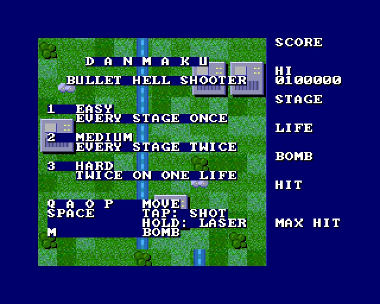
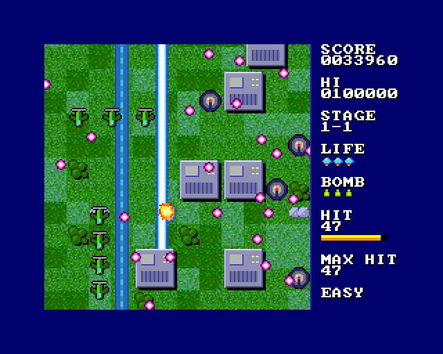
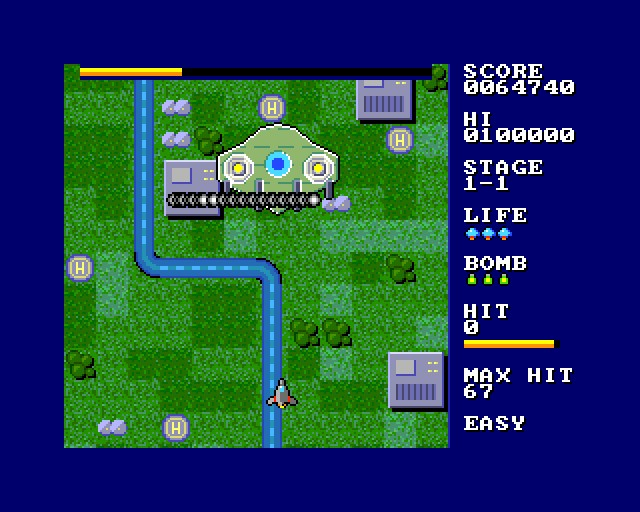
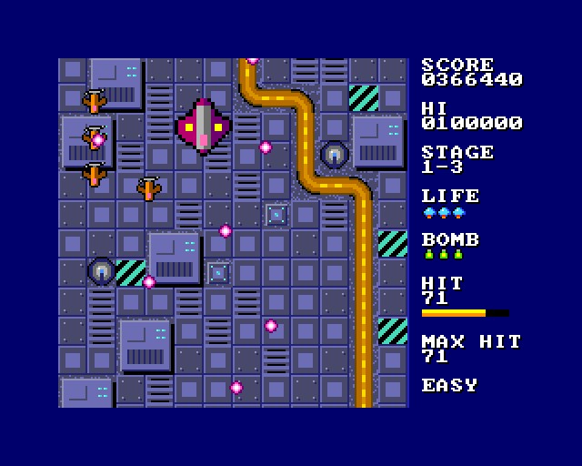
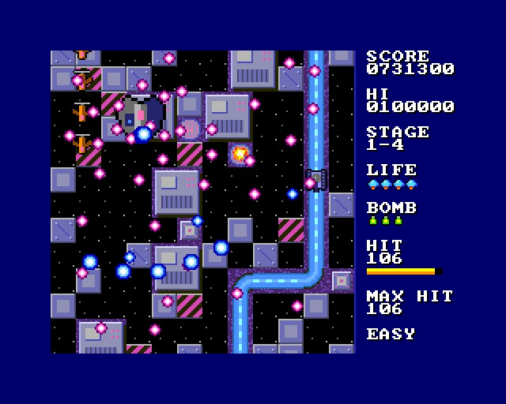
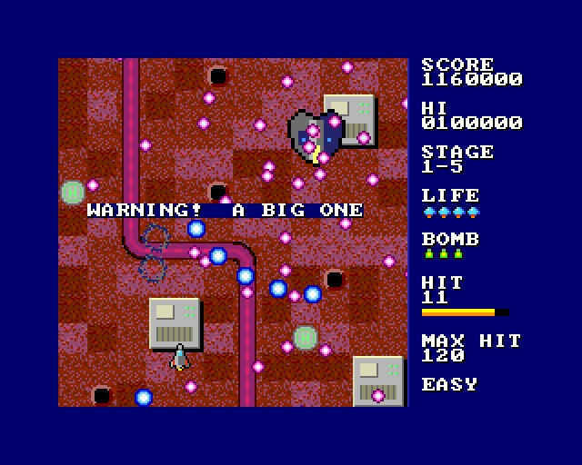
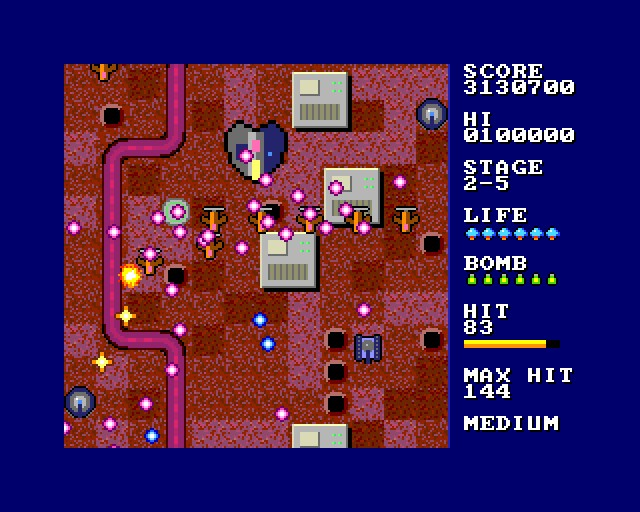

# DANMAKU - a bullet hell shooter

(c) 2026 Cyborg Unicorn Pty Ltd - MIT License

A vertical scrolling bullet hell shooter in the DoDonPachi style, for the **ZX Spectrum Next**,
written in **NTC BASIC**. The bullet engine and the scrolling are in Z80. There are 5 stages,
each ending in a boss.

All names, art and stages are original.

## Modes

| | |
|---|---|
| **1 Easy** | Clear every stage once (5 stages). 3 lives. |
| **2 Medium** | Clear every stage twice (10 stages). The second loop is faster and meaner. 3 lives. |
| **3 Hard** | The same two loops, on 1 life. No extra lives. |

**What changes in the second loop:**
- Bullets are 25% faster.
- Enemies have 25% more life, and bosses 50% more.
- Waves come quicker.
- Boss guns fire a quarter faster.
- Popcorn fighters fire spreads instead of single bullets.
- Fighters fire one last bullet at you as they die.

## Keys

| | |
|---|---|
| Q A O P | move |
| Space (or Kempston fire) | tap: a spread of shots; hold: the laser |
| M, Enter (or Kempston fire 2) | bomb |

## How it plays

- **Shot and laser:** tapping fire gives a burst of shots, which spread wider as your power goes
  up (P items). Holding fire switches to the laser. It hits the nearest target straight above you
  and does more damage, but you move at half speed while it's on.
- **Hit box:** only the middle of your ship can be hit, about 7 pixels across. Bullets that only
  touch the wings miss.
- **Bombs:** a bomb flashes the screen for about a second. During that second it:
  - clears every bullet
  - damages everything on screen
  - keeps you safe.

  You get 3 bombs each life, and B items add more (6 at most).
- **HIT chain:** each kill adds 1 to the chain and refills the gauge. Any damage you deal also
  refills the gauge. When the gauge runs out, the chain drops to 0. Each kill scores its value
  plus 20 x the chain. Beating a boss adds the chain x 500.
- **Items:**
  - Carriers (the big blue planes) drop P (power) or B (bomb).
  - Gunships drop a score medal.
  - Losing a life costs one power level.
- **Game over / all clear:** the message stays 6 seconds; after the first second, Space (or
  fire) skips it.
- **Extra lives** (Easy and Medium only): at 500,000 points, then every 1,000,000.

## The stages

Each stage has its own colours, ground and boss:

| Stage | Place | Boss |
|---|---|---|
| 1 | Coast: grass, a river, buildings | the Warden |
| 2 | Desert base: sand, roads, craters | the Sand Crawler |
| 3 | Fortress: steel plate, a lava channel | the Iron Citadel |
| 4 | Orbit: open space, energy conduits | the Orbital Lance |
| 5 | Hive: living ground and veins | the Hive Queen |

**Enemies:**
- Small fighters come in lines, weaving columns and side sweeps.
- Divers swoop and fire a fan.
- Tanks drive up the road.
- Guns sit on the pads and fire rings.
- Carriers.
- Gunships stop to spray spirals.

Each boss has three phases, which change as its life drops (the bar along the top). Each phase
uses two guns: rings, aimed fans, spirals and walls.

## How it uses the hardware

- **Layer 2, scrolling:** `Bg.cls` sets Layer 2 to 256 x 192 in bank 16, with a clip window
  showing the left 192 pixels as the play area.
  - The hardware scroll (NextReg #17) moves the picture down a line every frame. Just after
    `Frame`, `Bg.Scroll` draws the one new line at the top: 12 blocks x 16 bytes.
  - So the background costs about 200 bytes of writing a frame, not 36K.
  - The blocks are 24 pictures of 16 x 16. Their pixels are colour numbers 0-47, and each stage
    sets the Layer 2 palette for those 48 colours. That's how one set of blocks makes five places.
  - `Main.MakeRow` makes the map one block row at a time, 16 lines ahead. It lays the ground,
    the winding path (river, road, lava, conduit, vein), the two-by-two buildings, and the pads
    where the guns sit.
- **Bullets:** `Bul.cls` handles 60 enemy bullets and 18 player shots as hardware sprites 50-127.
  Each frame, all in Z80, it:
  - moves them (8.8 fixed point)
  - drops the ones that have left the play area
  - checks the bullets against the ship
  - checks the shots against up to 24 target boxes
  - builds their sprite attributes.

  `Bul.Show` then sends all 78 sprites with two `OTIR`s.
  - `Fire` turns a way (0-255) and a speed into a velocity with a sine table and the Next's
    `MUL D,E`.
  - `Laser` finds the nearest box above the ship.
  - `Aim` gives the way from one point to another.
- **Sprites 0-47** (`Spr.cls`): the ship, the laser beam, enemies, explosions, items, and the
  boss (4 x 3 sprites). They are cut to the play area by the sprite clip window, which applies
  in over-border mode with NextReg #15 bit 5.
  - The 4 bit patterns use 11 palettes: the art, a white hit-flash, pink, blue and gold bullets,
    one palette per boss, and darker enemy colours for stages 3-5.
- **Tilemap, on top** (layer order USL): the panel, the boss's life bar and the messages. The play
  area cells are see-through.
- **AY:** shots, the laser, explosions, bombs, items, the warning.

It runs at 50 frames a second, logic and all, measured in the emulator over the whole of stages
1-5 in a scripted run. The emulator is a 28MHz Next with no memory wait states, and the game
hasn't been run on real hardware yet.

## Files

- `Main.bas`: the game.
- `Bul.cls`: the bullet engine.
- `Bg.cls`: the scrolling background.
- `BgData.cls`: the background blocks and the stages' colours. Made by `tools/bgart.py`; edit
  that and run `python3 tools/bgart.py`.
- `GfxData.cls`: the tiles and sprites. Made from `gfx/` by `gfxtool.js`; edit the PNGs and
  `layout.txt`, then rebuild.
- `Nx.cls`, `Spr.cls`, `Tiles.cls`, `Sfx.cls`: NextRegs, sprites, the tilemap, AY sound.
- `build.js`, `game.json`, `DANMAKU.json` (the IDE project).
- `build/`: `DANMAKU.asm` and `DANMAKU.NEX`, ready to run.

## Building it

- **IDE:** open `DANMAKU.json` in NTC BASIC's IDE (`ntc.html`), then **Save .asm** and run
  `sjasmplus DANMAKU.asm`.
- **Command line:** `node build.js path/to/ntc/src` rebuilds the art, the project, the `.asm` and
  the `.NEX` (when sjasmplus is on the PATH).
- **Running it:** copy `DANMAKU.NEX` to the SD card and run it from the browser.

## Screenshots

Taken in an emulated Next:

