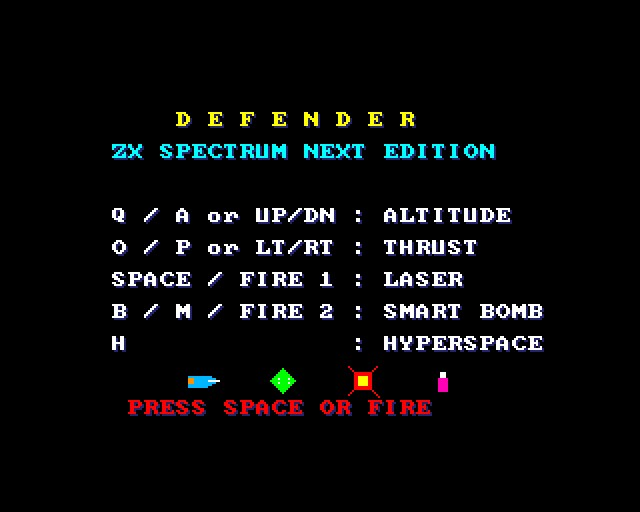
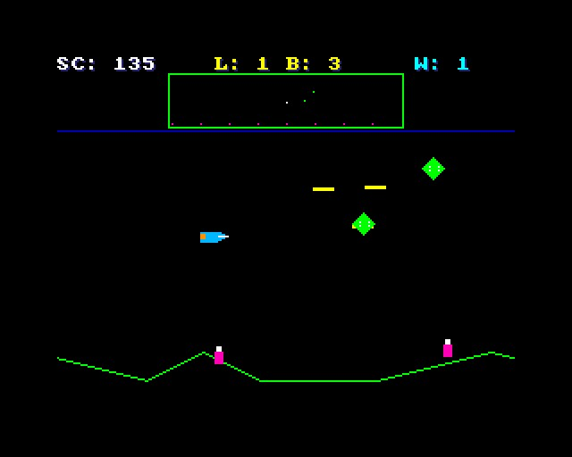
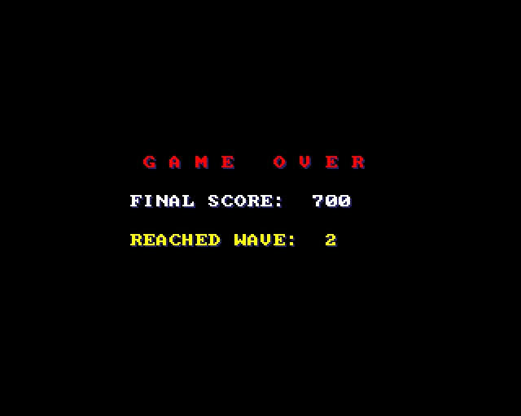

# DEFENDER - ZX Spectrum Next Edition (NTC BASIC build)

Your friend's Defender, made to compile and run under **NTC BASIC** on the **ZX Spectrum Next**.
The game itself (the ship, landers, mutants, humans, abductions, smart bombs, hyperspace, the
scanner, the waves) and his sprite hardware code are his. `original_Main.bas` is his file as it
came; `Main.bas` is the working one, with the changes marked `NTC:`.

## What was changed

**To compile** (the original used statements NTC doesn't have):

| Original | Now |
|---|---|
| `Pen`, `Paper`, `Border`, `Locate`, `Print`, `Cls` (Amstrad CPC style) | small Subs of the same names at the bottom of `Main.bas`: the words go on the tilemap (`Board.cls`, a colour per pen), `Locate` became `At`, `Print` became `PrintS`, `Cls` became `ClsAll` |
| `Plot`, `Draw` (CPC style, y counting up from the bottom) | Subs of the same names drawing on Layer 2 (`L2.cls`), y turned over, lines by Bresenham |
| `Sound` | a Sub of the same name playing it on the AY (`Sfx.cls`) |
| `Vsync` | a Sub: `Frame` (plus the sound and the copper list) |
| `Key(n)`, `Joy(n)` | Functions of the same names: his key numbers mapped to the Next's keys (`Keys.Down`), the joystick (`Keys.Joystick`) turned into his bit layout |
| `Return value` in Functions | the value assigned to the function's name |
| `(sx >> 8)` | `(sx \ 256)` (NTC has no `>>`) |
| `Open` / `Get #1` / `Close` for `DEFENDER.SPR` | `FileSystem.Load` into a buffer. The Next build of NTC has no file support yet, so it always uses his built-in sprites; the file is used where files work |
| `Dim` inside the main loop | moved to the top |

**To work right:**

- **Layer order:** he set NextReg `&H15` to `&H03` (SLU: Layer 2 over the tilemap). Now `&H0B`
  (SUL), so the words show over the drawing.
- **Score** is a `Long` (an `Integer` stops at 32,767).
- **Putting a rescued human down:** humans stand at y 16-32 but the ship can't fly below
  `PLAY_TOP` (40), and a carried human hangs 10 below the ship, so it could only touch down on the
  highest hills. Now flying as low as the ship goes puts the human down.
- **The terrain:** he redrew one 32-pixel slice of it per frame while the view scrolled every
  frame, so it smeared and broke up. Redrawing all of it each frame with `Plot` / `Draw` took 5
  frames. Now the bottom of the screen is scrolled by the copper (Layer 2's sideways scroll, from
  line 160 down: `Scroll.cls`) and only the columns coming into view are drawn. It runs at the full
  50 frames a second.
- **Title:** the four preview sprites moved down (they sat on the HYPERSPACE line); the font has
  lower case (for "or").

Everything else is as he wrote it, including the game's balance: at 50 frames a second it's
quick and the enemies shoot a lot.

## Keys

| | |
|---|---|
| Q / A (or joystick up / down) | altitude |
| O / P (or joystick left / right) | thrust |
| Space, Z (or fire 1) | laser |
| B, M (or fire 2) | smart bomb |
| H | hyperspace |

## Files

- `Main.bas`: the game (changes marked `NTC:`); `original_Main.bas`: his original.
- `Scroll.cls`: the copper list that scrolls the terrain.
- `Board.cls` (the words), `L2.cls` (Layer 2), `Sfx.cls` (AY sound), `Tiles.cls`, `Nx.cls`,
  `Spr.cls`, `GfxData.cls` (the font: made from `gfx/` by `gfxtool.js`; the PNGs from
  `tools/art_defender.py`).
- `build.js`, `game.json`, `DEFENDER.json` (the IDE project).
- `build/`: `DEFENDER.asm` and `DEFENDER.NEX`, ready to run.

## Building it

- **IDE:** open `DEFENDER.json` in NTC BASIC's IDE (`ntc.html`), then **Save .asm** and run
  `sjasmplus DEFENDER.asm`.
- **Command line:** `node build.js path/to/ntc/src`.
- **Running it:** copy `DEFENDER.NEX` to the SD card and run it from the browser.

It runs in the emulator. It hasn't been run on real hardware yet.

## Screenshots

