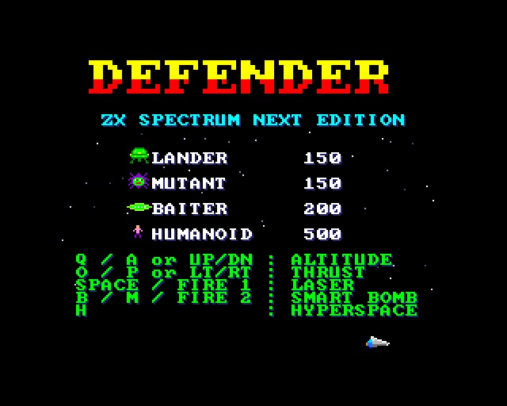
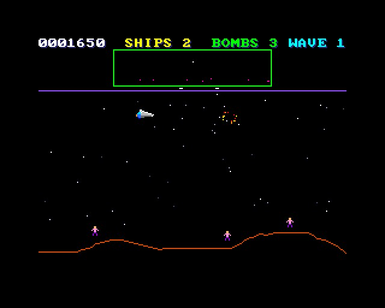
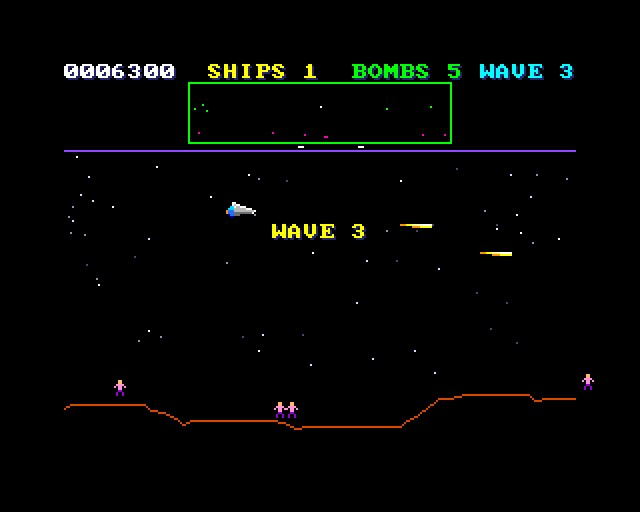
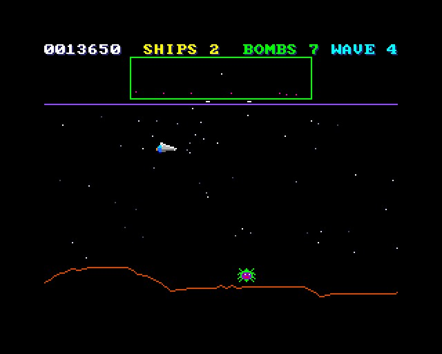

# DEFENDER - ZX Spectrum Next Edition (NTC BASIC)

Your friend's Defender, running under **NTC BASIC** on the **ZX Spectrum Next**, with better
graphics, sound and play. `original_Main.bas` is his file as it came. `Main.bas` keeps his world,
his sprite hardware code, his landers, mutants, humans, scanner and controls, and builds on them.

## What's new

**Graphics**
- 16 sprite patterns instead of 5 (`tools/sprites.py` makes them; `SprData.cls` builds them in;
  `DEFENDER.SPR` is the same set as a file, and replaces it where NTC has files):
  - the ship with a flickering engine flame when thrusting
  - landers and mutants with two frames each
  - humans that walk
  - an enemy shot, a four-frame explosion and the baiter
- **Stars** behind, scrolling at a quarter of the ground's speed. The copper changes Layer 2's
  sideways scroll three times down the screen: none for the scanner, slow for the sky, full for
  the ground (`Scroll.cls`).
- **A proper landscape:** 1024 pixels of hills and mountains all the way round. His repeated the
  same 256 pixels four times.
- **The scanner** shows where the screen is (marks above and below it).
- **The ship slides across the screen** when it turns round, so there's room ahead; it used to
  jump.
- **Explosions** for everything shot, and for the ship.
- **Screens:** a title with the enemies and their points, "WAVE n" at the start of each, "ATTACK
  WAVE n COMPLETED" with the bonus at the end.

**Sound** (on the AY)
- Laser zap, explosions (noise), the engine's rumble while thrusting, the warble of a lander
  grabbing a human, the scream of one falling to its death, catching a human and setting one
  down, the smart bomb's roar (with the screen flashing white), hyperspace, the ship blowing up,
  the end-of-wave tune, the extra-ship chime.

**Play**
- **Losing a ship doesn't start the wave again.** Before, it put a fresh set of enemies on and
  reset the count, so a wave could never be finished by losing ships. Now the enemies near you
  are moved away, the shots are cleared, and you get two seconds of safety (the ship flashes).
- **Enemy fire** is aimed at the ship and less of a hail. It was 1 in 35 a frame per enemy at
  50 frames a second; now landers 1 in 220, mutants 1 in 140, baiters 1 in 60. No firing point
  blank.
- **Humans:**
  - Landers come down for them less often.
  - Shoot the lander and the human falls. Catch it for 500.
  - Set it down for 500.
  - If it falls from high up, it dies. A short fall is safe: 250.
- **The baiter:** if a wave goes on for 40 seconds, a fast saucer comes after you (and another
  every 12 seconds).
- **Scoring:** landers and mutants 150, baiters 200. At the end of each wave, 100 × the wave
  number for each human left (up to 5000).
- **An extra ship and smart bomb every 10,000**, and a smart bomb each wave (up to 5).
- **Waves** have more enemies as you go (12, 14, 16 … up to 24).
- **Every fifth wave** the humans and the planet come back.
- The ship flies lower (down to the hilltops), and no longer up into the scanner.

## Keys

| | |
|---|---|
| Q / A (or joystick up / down) | altitude |
| O / P (or joystick left / right) | thrust |
| Space, Z (or fire 1) | laser |
| B, M (or fire 2) | smart bomb |
| H | hyperspace |

## How it runs

His CPC-style statements (`Pen`, `Plot`, `Draw`, `Sound`, `Vsync`, `Key`, `Joy` …) are Subs at
the bottom of `Main.bas`. The words are on the tilemap (`Board.cls`) and the drawing on Layer 2
(`L2.cls`). The terrain is drawn a column at a time as it comes into view, the copper doing the
scrolling. It runs at the full 50 frames a second in the emulator. It hasn't been run on real
hardware yet.

## Files

- `Main.bas`: the game. `original_Main.bas`: his original.
- `SprData.cls`: the sprites built in (made by `tools/sprites.py`, which also writes
  `DEFENDER.SPR`).
- `Scroll.cls`: the copper list for the sky and ground scrolling.
- `Board.cls`, `L2.cls`, `Sfx.cls`, `Tiles.cls`, `Nx.cls`, `Spr.cls`, `GfxData.cls` (the font, from
  `gfx/` by `gfxtool.js`; the PNGs from `tools/art_defender.py`).
- `build.js`, `game.json`, `DEFENDER.json` (the IDE project).
- `build/`: `DEFENDER.asm` and `DEFENDER.NEX`, ready to run.

## Building it

- **IDE:** open `DEFENDER.json` in NTC BASIC's IDE (`ntc.html`), then **Save .asm** and run
  `sjasmplus DEFENDER.asm`.
- **Command line:** `node build.js path/to/ntc/src` (run `python3 tools/sprites.py` first if you
  change the sprites).
- **Running it:** copy `DEFENDER.NEX` to the SD card and run it from the browser.

## Screenshots

