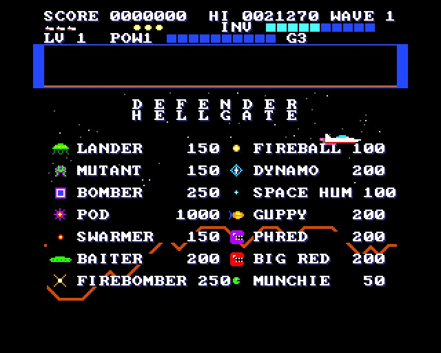
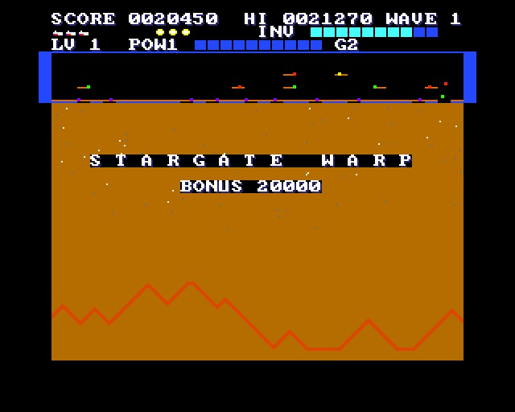
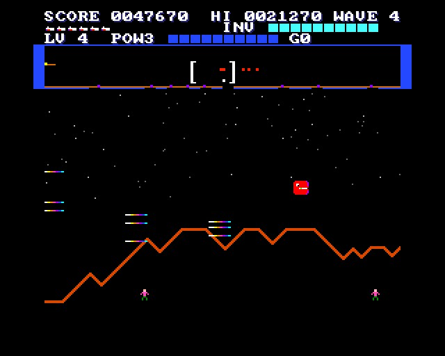
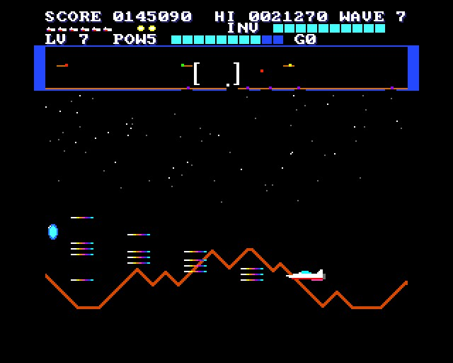
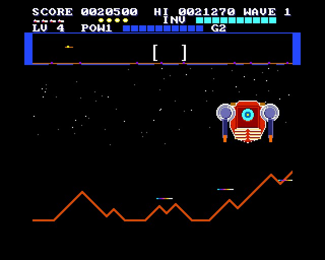
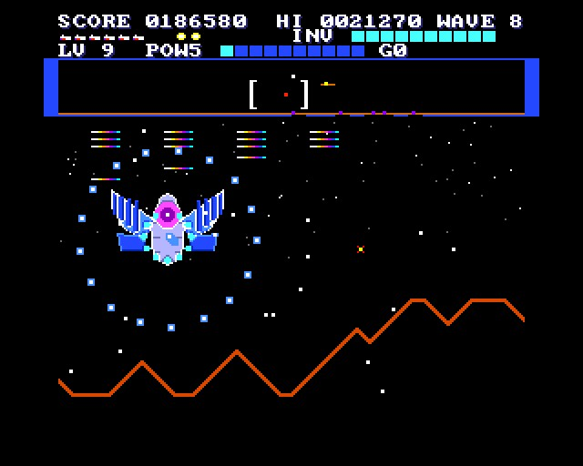
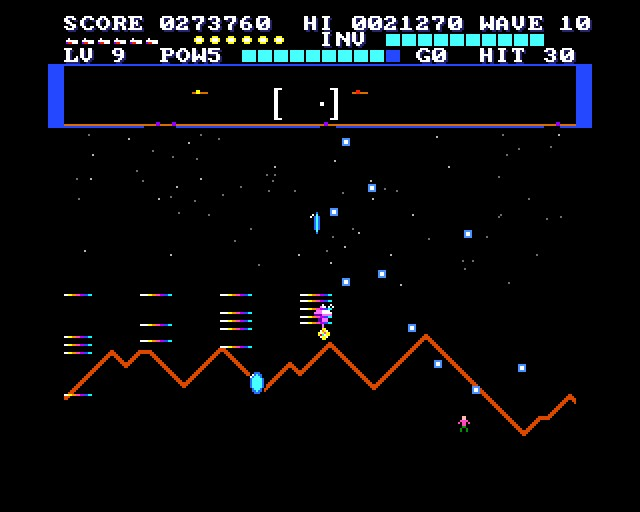

# DEFENDER HELLGATE

(c) 2026 Cyborg Unicorn Pty Ltd - MIT License

DEFENDER HYPERSPACE crossed with MECHRA, for the **ZX Spectrum Next**, written in **NTC BASIC**:
Stargate's Defender, with bullet hell, MECHRA's power-ups and giant mechs. Same graphics as
DEFENDER HYPERSPACE, with MECHRA's pickups, guard and giant mechs added. It never ends.

## Everything from DEFENDER HYPERSPACE

- **The planet:** 2048 pixels round, with the scanner, the landers taking the humanoids up and turning mutant.
- **Rescues:** catching falling humanoids (500, 1000, 1500, 2000) and setting them down.
- **The planet exploding** when the humanoids are all gone. Every lander turns mutant, and the planet
  comes back on waves 6, 11, 16 and so on.
- **The full Stargate cast:** landers, mutants, bombers, pods, swarmers, baiters, firebombers,
  fireballs, dynamos, space hums, Yllabian space guppies, Phred, Big Red and munchies.
- **Stargate's own wave line-ups:** the Yllabian Dogfight every 5th wave and the Firebomber Showdown every 10th.
- **The Stargate itself:** it takes you to a humanoid in trouble. With 4 or more aboard, before wave 10, it warps you 3 waves on.
- **The other abilities:** Inviso, smart bombs, hyperspace, and an extra ship, smart bomb and Inviso every 10,000.

## New: from MECHRA

- **Pickups:** what you shoot drops them. Pods, bombers and firebombers drop more, and big Ps.
  - **P** (blue, spinning): ten P is a power level.
  - **Big P** (gold): a whole power level at once.
  - **Gems:** score (more with a HIT chain going).

  They pop out and drift down. Fly close (or guard) and they fly to you. They fade after
  about 10 seconds or when they reach the ground.
- **Power levels 1-5:** your laser.
  - Level 1: one beam.
  - Level 2: two.
  - Level 3: two, plus one angled up or down in turn.
  - Level 4: the same, faster.
  - Level 5: three beams and two angled, fast.

  Losing a ship costs a power level. Past level 5, a big P is 2,000.
- **GUARD (G):** a barrier round the ship for two seconds. It eats every bullet on the screen
  (10 each) and turns every four into a gem; nothing hurts you while it's up. You start with 3,
  and every 25 P is another.
- **HIT chain:** kills in quick succession build it (HIT n on the panel). Each kill while it
  lasts is worth 10 more per link.
- **Bullet hell:** the enemies shoot faster, and in pairs then fans as the level goes up. From
  level 3, pods, dynamos, bombers and firebombers fire rings.

## Levels and bosses

- **The level** starts at 1. At the end of every wave (and at a Stargate warp), the humanoids
  still alive count as saved. **Every 8 saved is a level.** Keep all ten alive and it's a level
  most waves. Lose them and it stalls until the planet comes back.
- **Every third level (3, 6, 9 ...) there's a boss level**, after the wave:
  - The ground stays. The humanoids are kept out of it (they're back, as they were, after).
  - A **giant mech** (MECHRA's five, in turn) keeps in front of you and fills the sky: aimed
    fans and rings, then twin spirals, then rings, fans and a spiral all at once as it's hurt.
  - Swarmers come in to help it. A smart bomb takes a chunk off it, and running into it kills you.
  - Its strength goes up with each one (80 + 40 per boss), and its bullets get faster with the level.
  - **Beat it for 10,000 × the boss's number** (the first 10,000, the second 20,000 ...), plus
    ten points a hit and a shower of big Ps and gems.
- **The game never ends:** the waves and levels just keep going up, until your ships run out.

The panel's bottom line: **LV** the level, **POW** the power level and the P toward the next
(the bar), **G** guards left, **HIT** the chain.

## Keys

| | |
|---|---|
| Q / A (or 7 / 6, or joystick up / down) | up / down |
| O / P (or 5 / 8, or joystick left / right) | turn and thrust |
| Space (or M, fire) | laser |
| B (or Enter, fire 2) | smart bomb |
| G | guard |
| I (or N) | Inviso (hold) |
| H | hyperspace |

## How it works

- **The planet** is on Layer 2 (`Land.cls`, made by `tools/land.py`). It's drawn a column at a
  time as it comes into view, and the copper scrolls the stars at a quarter of the mountains' speed.
- **The sprites:** DEFENDER HYPERSPACE's (`tools/art_defhyper.py`), with MECHRA's pickups, guard and
  giant mechs added below them by `tools/merge_mechra.py`. It takes them from
  `tools/mechra/` (made by `tools/mechra/art_mechra.py`) colour number for colour number. Their
  colours come with them as sprite palette rows 8 (the pickups, the guard) and 9-13 (the giant
  mechs). 87 patterns.
- **The giant mechs** are 64 × 48, 12 sprites. Only their left halves are stored; the right
  halves are the same sprites, mirrored.
- **The sprite slots:** the enemies 2-25 (in a boss level 2-13; the boss 14-25), the pickups
  26-31, the guard 32, the humanoids 34-43, the explosions 44-51, the scanner window 52, the
  Stargate 53, and the bullets and lasers 54-127 (`Bul.cls`, in Z80).
- **Memory:** the sprite patterns and the tiles are loaded from bank 5 and bank 47 (game.json's
  `bank5`, `gfxbank` and `banks`), so they don't take the program's RAM.

It runs at 44-50 frames a second in the emulator. It hasn't been run on real hardware yet.

## Files

- `Main.bas`: the game.
- `Land.cls`: the planet: the mountains, the stars and the copper list.
- `Bul.cls`: the bullets and the laser.
- `GfxData.cls`: the tiles and sprites, made from `gfx/` by `gfxtool.js`.
- `Nx.cls`, `Spr.cls`, `Tiles.cls`, `Sfx.cls`: NextRegs, sprites, the tilemap, AY sound.
- `tools/`:
  - `art_defhyper.py` (needs `artkit.py` and `cvkit.py` beside it), `merge_mechra.py`, `land.py`.
  - `mechra/`: MECHRA's art script and its sheet.
- `build.js`, `game.json`, `DEFHELL.json` (the IDE project).
- `build/`: `DEFHELL.asm` and `DEFHELL.NEX`, ready to run.

## Building it

- **Command line:**
  1. If you change the sprites: `python3 tools/art_defhyper.py`, then
     `python3 tools/merge_mechra.py` (and `python3 tools/mechra/art_mechra.py` first if you
     change MECHRA's).
  2. If you change the mountains or the stars: `python3 tools/land.py`.
  3. `node build.js path/to/ntc/src`: the tiles and sprites, the project, the `.asm` and the
     `.NEX`.
- **IDE:** open `DEFHELL.json` in NTC BASIC's IDE (`ntc.html`) and **Save .asm**. Before running
  `sjasmplus DEFHELL.asm`, change its line `SAVENEX BANK 5, 8, 9, 10` to:

  `SAVENEX BANK 5, 8, 9, 10, 47`

  That's the only difference from what `build.js` makes.
- **Running it:** copy `DEFHELL.NEX` to the SD card and run it from the browser.

## Screenshots

Taken in an emulated Next:

