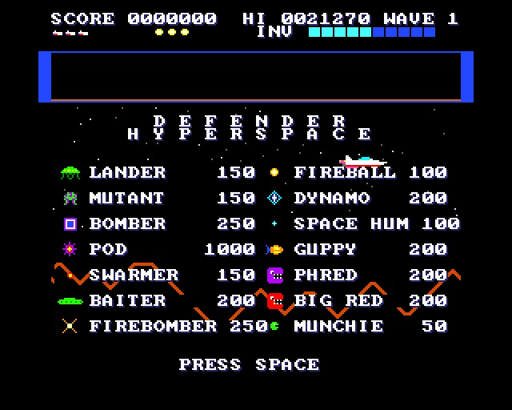
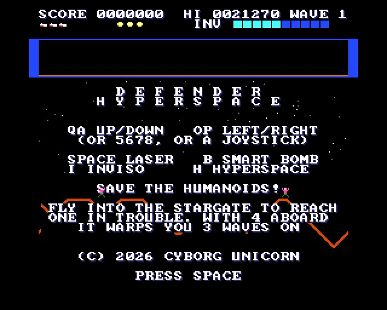
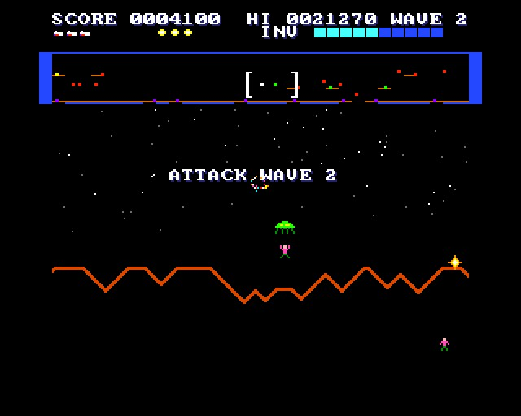
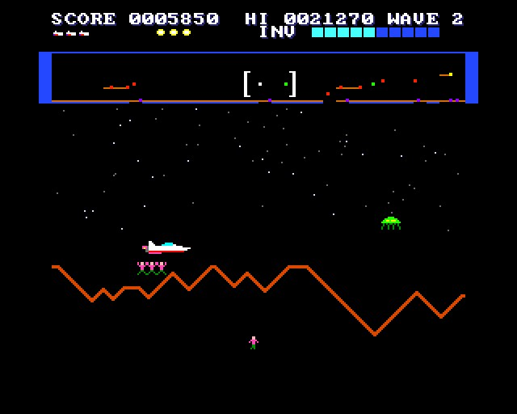
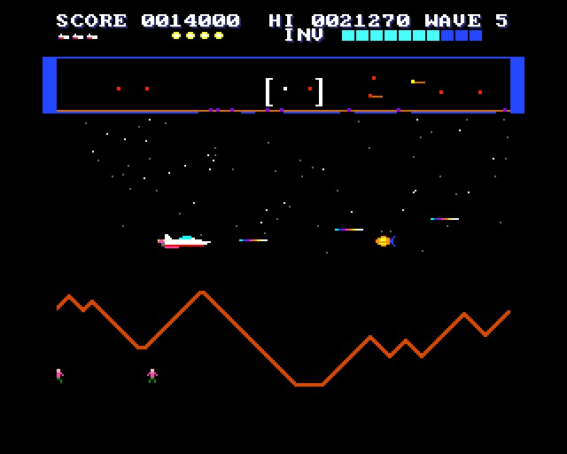
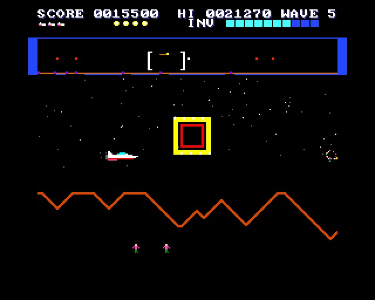
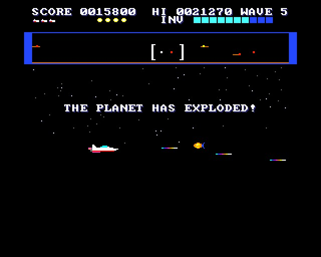

# DEFENDER HYPERSPACE

(c) 2026 Cyborg Unicorn Pty Ltd - MIT License

A Stargate-style Defender for the **ZX Spectrum Next**, written in **NTC BASIC**. It follows the 1981
arcade sequel to Defender. That means the Stargate, Inviso, the Yllabian Dogfight and the
Firebomber Showdown, and the full Stargate cast with its point values and its wave line-ups.

## How it plays

- **The planet** is 2048 pixels round (eight screens), with a jagged mountain line along the
  bottom. Fly off one end and you come back on at the other. The scanner at the top shows all of
  it, with you in the middle and a bracket for the part on the screen. In the scanner, landers are
  green, other enemies red, humanoids purple, the Stargate yellow and you white.
- **Landers** come down for the ten humanoids and carry them up. A lander that gets one to the
  top turns into a **mutant**.
- **Shoot a lander carrying a humanoid** and the humanoid falls. Catch it and you get 500, 1000,
  1500, then 2000 for each catch in a row. You can carry as many as you catch. Fly down to the
  ground to set them all down, for 500 each. A humanoid that falls from low down lands safely
  (250). From high up, it dies. Your laser kills humanoids too.
- **The last humanoid on the ground taken:** "PLANET SURFACE UNSTABLE!". Lose them all and the
  planet explodes: the mountains go, and every lander becomes a mutant. The planet and ten
  humanoids come back on waves 6, 11, 16 and so on.
- **The Stargate** sits at one spot on the planet. Fly into it and it takes you to:
  1. a humanoid that is falling, or else
  2. the lander carrying a humanoid that is nearest the top, or else
  3. the far side of the planet.

  Fly into it to the right with **4 or more humanoids aboard**, before wave 10, and it **warps you
  3 waves on**. The warp bonus is 2000 for each humanoid left (20,000 at most).
- **Inviso** is a cloak. While you hold the key, nothing can hurt you, and anything you fly into
  dies. It runs down while it's on; the bar in the panel shows what's left.
- **Smart bombs** destroy everything on the screen. **Hyperspace** puts you somewhere at random,
  and 1 time in 5 you don't come out of it in one piece.
- **Every 10,000** gives you an extra ship, a smart bomb and more Inviso.
- **Too slow:** after 40 seconds the baiters come for you, then Phred and Big Red. Phred and Big
  Red spit munchies.

## The cast

| | Points | |
|---|---|---|
| Lander | 150 | takes humanoids up; mutates at the top |
| Mutant | 150 | homes in, jitters, shoots in pairs |
| Bomber | 250 | drifts, lays mines |
| Pod | 1000 | bursts into 4-7 swarmers |
| Swarmer | 150 | fast, overshoots, undulates |
| Baiter | 200 | keeps up with you; accurate shots |
| Firebomber | 250 | zig-zags; throws fireballs from wave 2 |
| Fireball | 100 | flies straight; can be shot |
| Dynamo | 200 | drifts; sheds space hums |
| Space hum | 100 | wobbles after you |
| Yllabian space guppy | 200 | swarms, wiggles, homes in |
| Phred / Big Red | 200 | fast chasers; spit munchies |
| Munchie | 50 | small, quick |

A wave ends when everything is down except fireballs, space hums, baiters, Phreds, Big Reds and
munchies.

## The waves (Stargate's own line-ups)

| Wave | Line-up |
|---|---|
| 1 | 11 landers, 2 dynamos, 3 firebombers |
| 2 | 10 landers, 2 dynamos, 3 firebombers, 7 guppies |
| 3 | 10 landers, 2 dynamos, 6 firebombers, 4 guppies, 3 pods |
| 4, 6-9 | 17 landers, 3 dynamos, 3 firebombers, 5 guppies, 4 pods (+2 bombers on 6, +3 on 7-9) |
| 5, 15, 25 ... | **Yllabian Dogfight**: 6 dynamos, 22 guppies, 8 swarmers. Bonus 2500 |
| 10, 20, 30 ... | **Firebomber Showdown**: 13 firebombers, 6 pods |
| 11 on | 18 landers, 4 dynamos, 4 firebombers, 3 guppies, 4 pods, 2 bombers |

Landers come in groups of five. The rest come in as there's room for them.

The end-of-wave bonus is for each humanoid left: 100 × the wave number on waves 1-4, then 500.

## Keys

| | |
|---|---|
| Q / A (or 7 / 6, or joystick up / down) | up / down |
| O / P (or 5 / 8, or joystick left / right) | turn and thrust |
| Space (or M, fire) | laser |
| B (or Enter, fire 2) | smart bomb |
| I (or N) | Inviso (hold) |
| H | hyperspace |

## How it works

- **The planet** is on Layer 2. `tools/land.py` makes the mountain line for all 2048 pixels and
  the stars, and writes them into `Land.cls`. The game draws a column of Layer 2 only when it comes
  into view, in Z80. The copper scrolls the stars at a quarter of the speed of the mountains.
- **The ship, the enemies, the humanoids and the explosions** are sprites. The ship is 32 × 16,
  with a flickering exhaust when thrusting. Mutants flash between two colour sets. Big Red is
  Phred in red. The Stargate is drawn at double size.
- **Enemy bullets and your laser** are moved and checked in Z80 (`Bul.cls`). Each enemy on the
  screen gets one of its 24 hit boxes. Humanoids being carried or falling get one too, so you can
  hit them.
- **The scanner and the panel** are the tilemap. The screen flashes for a smart bomb, the planet
  exploding or the Stargate, by changing Layer 2's black.

It runs at 44-50 frames a second in the emulator: 50 in normal play, a little less with 20+
enemies on the go. It hasn't been run on real hardware yet.

## Files

- `Main.bas`: the game.
- `Land.cls`: the planet: the mountains, the stars and the copper list. Made by `tools/land.py`.
- `Bul.cls`: the bullets and the laser.
- `GfxData.cls`: the tiles and sprites. `gfxtool.js` makes it from `gfx/`, and the PNGs come from
  `tools/art_defhyper.py` (it needs `artkit.py` and `cvkit.py`, which sit beside it).
- `Nx.cls`, `Spr.cls`, `Tiles.cls`, `Sfx.cls`: NextRegs, sprites, the tilemap, AY sound.
- `build.js`, `game.json`, `DEFHYPER.json` (the IDE project).
- `build/`: `DEFHYPER.asm` and `DEFHYPER.NEX`, ready to run.

## Building it

- **IDE:** open `DEFHYPER.json` in NTC BASIC's IDE (`ntc.html`), then **Save .asm** and run
  `sjasmplus DEFHYPER.asm`.
- **Command line:** `node build.js path/to/ntc/src` rebuilds the art, the project, the `.asm` and
  the `.NEX`. If you change the mountains or the stars, run `python3 tools/land.py` first. If you
  change the sprites, run `python3 tools/art_defhyper.py` first.
- **Running it:** copy `DEFHYPER.NEX` to the SD card and run it from the browser.

## Screenshots

Taken in an emulated Next:

