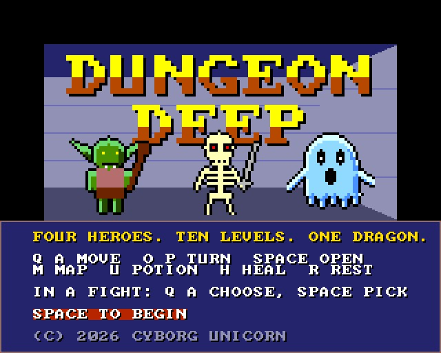
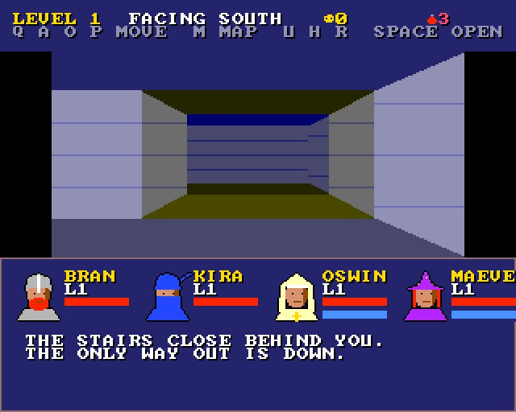
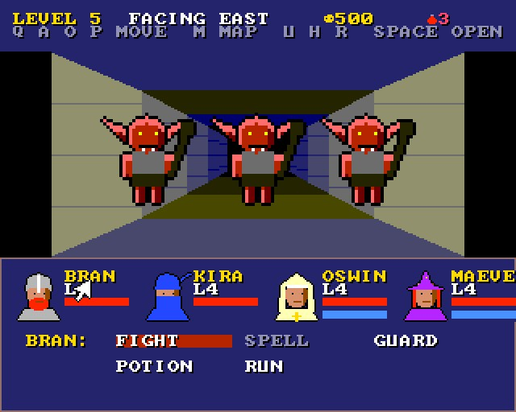
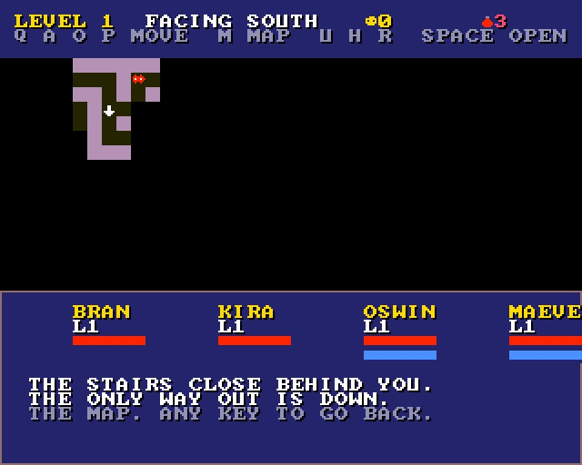
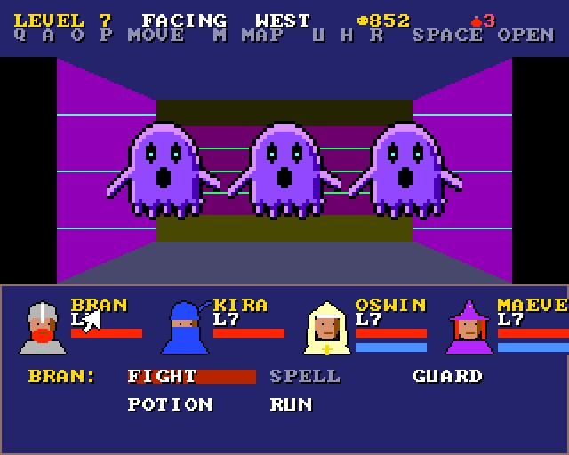
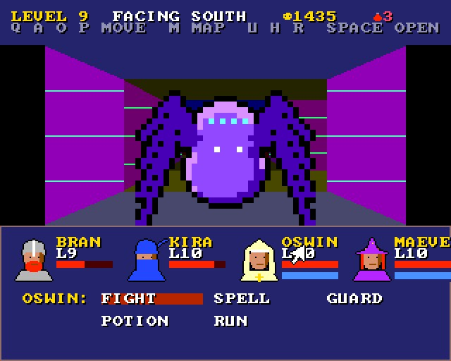
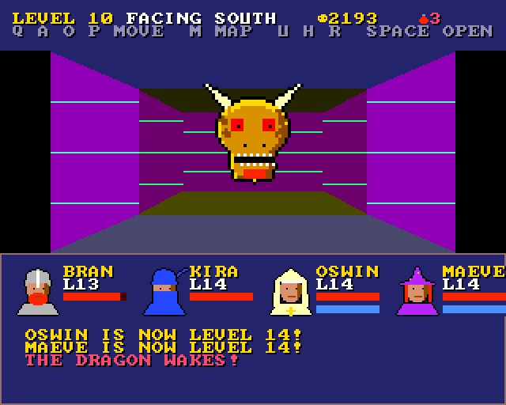

# DUNGEON DEEP

(c) 2026 Cyborg Unicorn Pty Ltd - MIT License

A Dungeon Master style dungeon crawl for the **ZX Spectrum Next**, written in **NTC BASIC**. Four
heroes, ten levels of maze seen through their eyes, monsters in groups of one to three, turn by
turn. At the bottom, the dragon.

## The party

| Hero | | Starts with | Good at |
|---|---|---|---|
| Bran | fighter | 40 HP, attack 8, defence 3 | hitting hard, taking hits |
| Kira | ninja | 30 HP, attack 7 | a deadly strike now and then (double damage) |
| Oswin | priest | 28 HP, 12 MP | healing one (4 MP), or everyone from level 3 (8 MP) |
| Maeve | wizard | 22 HP, 16 MP | a fireball at the whole group (5 MP), lightning at one (3 MP) |

Experience goes to everyone still standing. Each level up brings more HP (and MP for Oswin and
Maeve), attack and defence, and puts everyone back to full.

## The dungeon

- **Ten levels**, each a 32 x 32 maze of corridors with loops, a few rooms and wooden doors.
  Each level is made from its own number, so it's the same every game.
- **Moving is a turn.** Monsters that see you (five steps away or closer) come after you. Bump
  into a group, or let one reach you, and it's a fight.
- **Chests** sit in dead ends: gold, healing potions, a better weapon for Bran or Kira, or better
  armour for someone.
- **The stairs down** are as far from the start as the level goes. Taking them, the party rests
  first: half their HP and MP back, and anyone who fell gets up again.
- **The tenth level** has no stairs. The dragon sits on its hoard where they would be.

## The monsters

Twenty kinds, two new ones a level:

| Level | Monsters |
|---|---|
| 1 | giant rat, bat |
| 2 | goblin, slime |
| 3 | skeleton, giant spider |
| 4 | hobgoblin, vampire bat |
| 5 | ogre, ghost (blades often pass through it) |
| 6 | mummy, lava slime |
| 7 | troll, wraith (blades often pass through it too) |
| 8 | demon (breathes fire at everyone), phase spider |
| 9 | lich (casts fire at everyone), shadow demon (breathes fire) |
| 10 | the lich and the shadow demon again, fire mummies - and THE DRAGON |

Now and then a level has some of the level before's monsters too.

## A fight

Each round, each hero picks:
- **Fight:** hit one monster (O P to choose which).
- **Spell:** Oswin heals, Maeve casts.
- **Guard:** take half damage this round.
- **Potion:** for whoever's most hurt.
- **Run:** a bit better than even chances. Fail and the monsters get a free round.

Then the monsters have their go. They go for Bran and Kira at the front more often. A group's
experience and some gold are yours when the last one falls. If all four heroes fall, it's over.

## Keys

| | |
|---|---|
| Q / A | forward / back |
| O / P | turn left / right |
| Space | open the door or the chest in front of you |
| M | the map (the part you've seen) |
| U | a potion for whoever's most hurt |
| H | Oswin heals whoever's most hurt |
| R | rest: some HP and MP back, but the noise may bring something |
| In a fight | Q A O P choose, Space pick, O P the target |

## How it works

- **The view** is drawn on Layer 2 at each step: the floor and ceiling in bands darker with
  distance, then the walls from far to near - the faces of the walls further on, then the
  slanting side walls - five cells deep and two to each side. The walls are coursed stone
  (mortar lines), a different stone every few levels; doors are planks in a stone frame.
  It's drawn on a second Layer 2 screen out of sight and swapped in when it's finished, so you
  never see it half drawn.
- **The monsters** are 12 shapes drawn at 32 x 32 (`tools/art_dungeon.py`), each coloured by one
  of nine palette rows, so one shape makes two or three monsters (a goblin and a hobgoblin, an
  ogre and a troll). They're shown 1x, 2x or 4x by how far away they are and how many there are.
- **The heroes' faces** are sprites in the panel; hurt, they flash; fallen, they go grey.
- **The words, the panel and the map** are the tilemap, two bytes a cell so each line has its own
  colour (`Board.cls`).
- **Memory:** 64 of the sprite patterns are stored in bank 5 in the NEX file and loaded into the
  sprite RAM before the tiles go there (`"bank5": true` in `game.json`, read by `gfxtool.js`).

It runs in the emulator. It hasn't been run on real hardware yet.

## Files

- `Main.bas`: the game.
- `L2.cls`: Layer 2 drawing (spans, blocks, big letters).
- `Board.cls`: the tilemap with a colour per cell.
- `GfxData.cls`: the tiles and sprites. Made from `gfx/` by `gfxtool.js`; the PNGs come from
  `tools/art_dungeon.py` (it needs `artkit.py` and `cvkit.py`, which sit beside it).
- `Nx.cls`, `Spr.cls`, `Tiles.cls`, `Sfx.cls`: NextRegs, sprites, the tilemap, AY sound.
- `build.js`, `game.json`, `DUNGEON.json` (the IDE project).
- `build/`: `DUNGEON.asm` and `DUNGEON.NEX`, ready to run.

## Building it

- **IDE:** open `DUNGEON.json` in NTC BASIC's IDE (`ntc.html`), then **Save .asm** and run
  `sjasmplus DUNGEON.asm`.
- **Command line:** `node build.js path/to/ntc/src` rebuilds the art, the project, the `.asm` and
  the `.NEX`.
- **Running it:** copy `DUNGEON.NEX` to the SD card and run it from the browser.

## Screenshots

Taken in an emulated Next:

