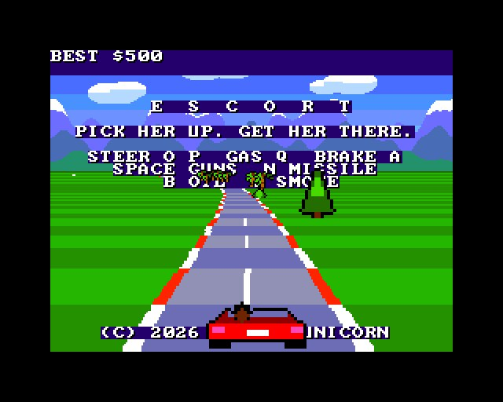
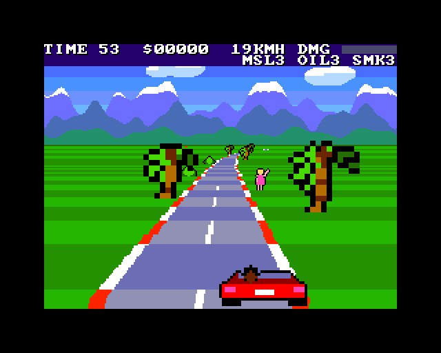
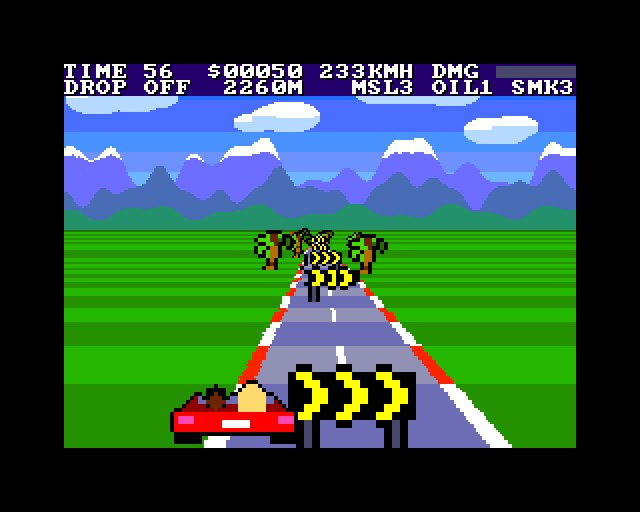
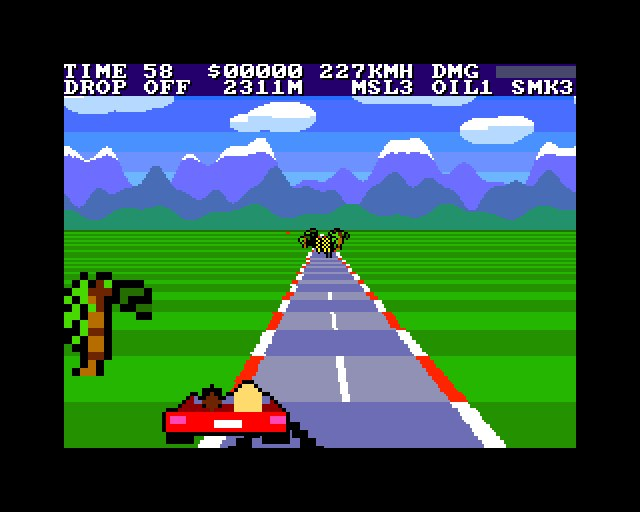
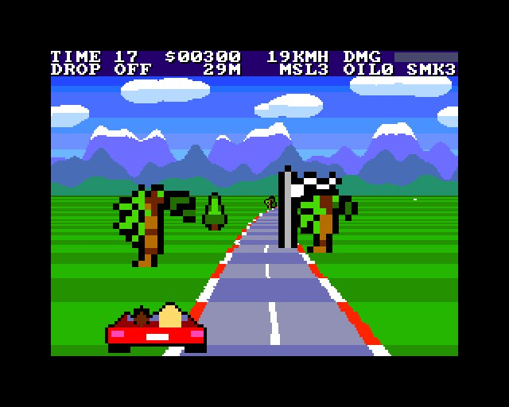

# ESCORT

(c) 2026 Cyborg Unicorn Pty Ltd - MIT License

A driving game for the **ZX Spectrum Next**, written in **NTC BASIC**. It looks like an arcade
racer: a red convertible on an open road, palms going past, mountains on the horizon.

## The job

You drive a cab.
1. **Pick her up.** She waits by the side of the road (on the right). Pull up next to her and stop,
   and she's in.
2. **Get her there.** Her stop is always straight ahead; the HUD counts down the metres. Stop by
   the **chequered flag** and collect the fare.
   - **The fare** is bigger the quicker you get her there, with a $50 tip if the car didn't take a
     scratch on the way.
   - **Each drop-off** also:
     - fills your gadgets back up
     - knocks a bit off the damage
     - adds 25 seconds to the clock.
3. **Do it again.** Each pick-up adds 15 seconds to the clock.

**On the way:**
- **Forks:** the road splits now and then.
  - The **signs** and a message say which way: keep left or keep right of the barrier.
  - **The wrong side** is the long way round: 1000 metres more to her stop.
  - **The barrier** is solid.
- **Traffic:** cars and trucks. Run into the back of one and it slows you down and dents the car.
- **Oil:** it spins you.
- **Logs:** a big bang, half your speed gone, and a lot of damage.
- **Off the road:** the grass slows you down, and the palms, cypresses and signs are solid.
- **Black cars** come for her once she's in the car, more of them as the jobs go on. They come up
  from behind, pull alongside and ram you off the road.

**The end:** the clock always runs, and the game is over when it runs out or the car is wrecked
(damage 100). Your best take is kept on the title screen.

## Gadgets

| | |
|---|---|
| **Machine guns** | Two streams of tracer straight up the road, as many as you like. Four hits stop a black car. |
| **Missiles** (3) | It flies up the road and steers itself into the nearest black car ahead. |
| **Oil slick** (3) | Dropped behind you. A black car that runs over it spins out. |
| **Smoke screen** (3) | Black cars behind you lose you and drop back. |

Every black car you stop is worth $50. The gadgets fill up again with each drop-off.

## Keys

| | |
|---|---|
| O P, or Z C, or 5 8 (or the joystick) | steer |
| Q, or S, or 7 (joystick up) | accelerate |
| A, or X, or 6 (joystick down) | brake |
| Space, M, 0 (Kempston fire) | machine guns |
| N (Kempston fire 2) | missile |
| B | oil slick |
| V | smoke screen |

## How it works

**The road and the sky** are one Layer 2 picture that never changes:
- **Rows 0-79:** the sky, clouds and mountains.
- **Rows 80-191:** 112 straight roads, one per row, each a little wider than the one above.

**The copper** (the Next's display co-processor) does all the work each frame. For every screen
line under the horizon it sets:
- **Horizontal scroll (NextReg #16):** this bends the road. The far lines move most for the bends
  and the near lines most for where you are across the road.
- **Palette offset (NextReg #70):** this switches between light and dark stripes by distance, so
  the kerbs, the grass and the dashes rush towards you.
- **Changes only:** it sends only what changes from the line above.

`Road.cls` builds the list in Z80 (using the Next's `MUL`) and loads it during the top border. The
hills move the horizon, and the sky scrolls round as the road bends.

**Everything by the road and on it is a sprite:**
- **Sizes:** each thing is drawn three times (at 1/2, 3/4 and full size) and shown at 1x, 2x or
  4x. That gives 8, 12, 16, 24, 32, 48 and 64 pixels.
- **Placing them:** `Road.Obj` works out each one's distance, size and place on the road in Z80.
- **Order:** they're kept sorted far to near, one sorting pass a frame, so near things are drawn
  over far ones.
- **Your car** is two sprites drawn twice the size.

**The HUD** is the tilemap; **the sound** is the AY.

It runs at 50 frames a second nearly all the time: about 97% of frames in a scripted run with
traffic, black cars and gunfire. That was measured in an emulator, to which I added the copper for
this game. **It hasn't been run on real hardware yet; the copper timing is the thing to check
there.**

## Files

- `Main.bas`: the game.
- `Road.cls`: the road: the rows, the copper list, placing the sprites.
- `Scenery.cls`: the sky. Made by `tools/scenery.py`; edit that and run `python3 tools/scenery.py`.
- `GfxData.cls`: the tiles and sprites. Made from `gfx/` by `gfxtool.js`; the PNGs come from
  `tools/art_escort.py` (run `python3 tools/art_escort.py`; it needs `artkit.py` and `cvkit.py`,
  which sit beside it).
- `Nx.cls`, `Spr.cls`, `Tiles.cls`, `Sfx.cls`: NextRegs, sprites, the tilemap, AY sound.
- `build.js`, `game.json`, `ESCORT.json` (the IDE project).
- `build/`: `ESCORT.asm` and `ESCORT.NEX`, ready to run.

## Building it

- **IDE:** open `ESCORT.json` in NTC BASIC's IDE (`ntc.html`), then **Save .asm** and run
  `sjasmplus ESCORT.asm`.
- **Command line:** `node build.js path/to/ntc/src` rebuilds the art, the project, the `.asm` and
  the `.NEX` (when sjasmplus is on the PATH).
- **Running it:** copy `ESCORT.NEX` to the SD card and run it from the browser.

## Screenshots

Taken in an emulated Next:

