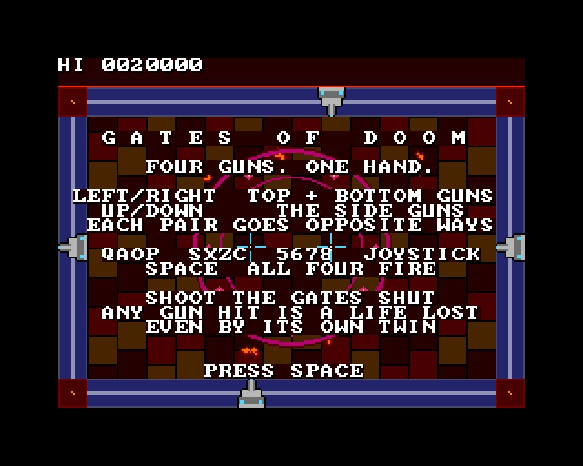
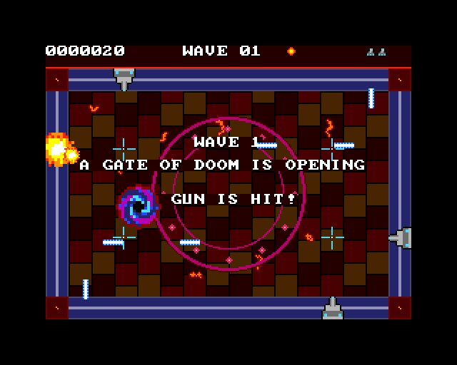
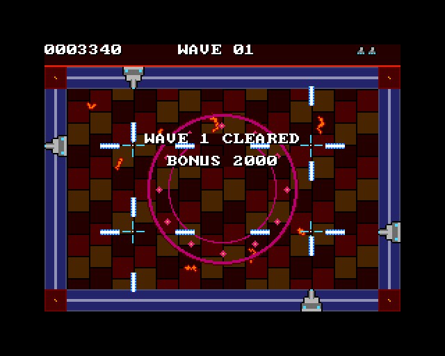
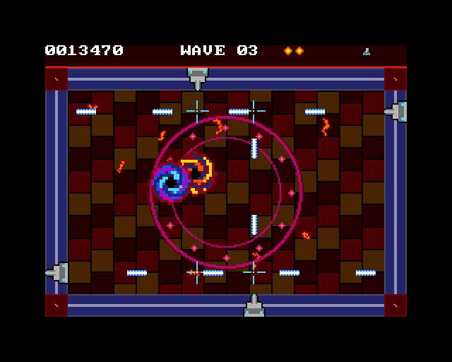
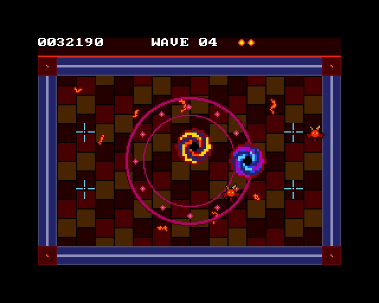

# GATES OF DOOM

(c) 2026 Cyborg Unicorn Pty Ltd - MIT License

A shooter in the style of Jeff Minter's *Hell Gate*, for the **ZX Spectrum Next**, written in
**NTC BASIC**. The art and names are original.

Four laser guns run on rails round the edge of the arena, and one hand moves all of them. Each
pair goes the opposite way to its twin:
- **Left / right** moves the top and bottom guns across: one goes left, the other right.
- **Up / down** moves the side guns: one goes up, the other down.
- **Fire** and all four shoot inwards together. Their lines cross in four places, each marked
  with a sight.

Gates of Doom open in the arena and pour out demons that go for your guns. Shoot the gates shut
and the demons down.

**Any gun hit is a life lost.** That covers:
- a demon reaching it
- a fireball
- its own twin's laser, when the two line up across the middle.

After a hit, the demons and fireballs are cleared and the guns flash for a moment while they
can't be hit. Every third wave cleared gives a life back (4 at most). It's meant to be hectic
and confusing.

## Keys

| | |
|---|---|
| Q A O P, or S X Z C, or the cursor keys 5 6 7 8 (or a Kempston joystick) | move the guns |
| Space, M (or Kempston fire) | fire (hold it down) |

## The demons

| | |
|---|---|
| Imp | homes in on a gun, wobbling. 1 hit, 100 points. |
| Wraith (from wave 2) | faster, straight at a gun. 2 hits, 150 points. |
| Skull (from wave 3) | bounces round the whole arena and spits fireballs. 3 hits, 200 points. |
| Fire fiend (from wave 4) | big and slow, spits fireballs. 8 hits, 500 points. |

**Gates:**
- Each wave opens more gates: 1, 1, 2, 2, 3, 3, then 4.
- Each gate takes more shooting every wave, and sends demons out faster.
- From wave 5 each gate sends them out two at a time.
- A gate glows red-hot when it's hit, and stays red when it's nearly shut.
- Shutting one scores 1000 x the wave.
- Clearing a wave scores a bonus of 2000 x the wave.

## How it uses the hardware

- **Layer 2:** the arena, one 256 x 192 picture: the flagstones, the lava cracks, the circle and
  the rails. It's packed in runs in `Arena.cls` and unpacked once at the start.
- **Sprites:**
  - the guns (one picture, turned and flipped for each side)
  - the four sights
  - the gates (turning vortices, drawn twice the size)
  - the demons and the explosions.

  The sprite clip window (with NextReg #15 bit 5) cuts them to the arena.
- **Shots and fireballs:** `Bul.cls`, the bullet engine from DANMAKU, changed for this game. Shots
  can now fly any of the four ways.
  - The guns are targets too, which is how a twin's laser is caught.
  - `Near` catches fireballs reaching a gun.
- **Tilemap:** the HUD (score, wave, gates open, lives) and the messages.
- **AY:** shots, hits, gates opening and shutting, demons coming out, fireballs, explosions.
- **Frame rate:** 50 frames a second, logic and all. That was measured in the emulator in a
  scripted run to wave 5; it hasn't been run on real hardware yet.

## Files

- `Main.bas`: the game.
- `Arena.cls`: the arena picture. Made by `tools/arena.py`; edit that and run
  `python3 tools/arena.py`.
- `Bul.cls`: the shots and fireballs.
- `GfxData.cls`: the tiles and sprites. Made from `gfx/` by `gfxtool.js`; edit the PNGs and
  `layout.txt`, then rebuild.
- `Nx.cls`, `Spr.cls`, `Tiles.cls`, `Sfx.cls`: NextRegs, sprites, the tilemap, AY sound.
- `build.js`, `game.json`, `GATES.json` (the IDE project).
- `build/`: `GATES.asm` and `GATES.NEX`, ready to run.

## Building it

- **IDE:** open `GATES.json` in NTC BASIC's IDE (`ntc.html`), then **Save .asm** and run
  `sjasmplus GATES.asm`.
- **Command line:** `node build.js path/to/ntc/src` rebuilds the art, the project, the `.asm` and
  the `.NEX` (when sjasmplus is on the PATH).
- **Running it:** copy `GATES.NEX` to the SD card and run it from the browser.

## Screenshots

Taken in an emulated Next:

