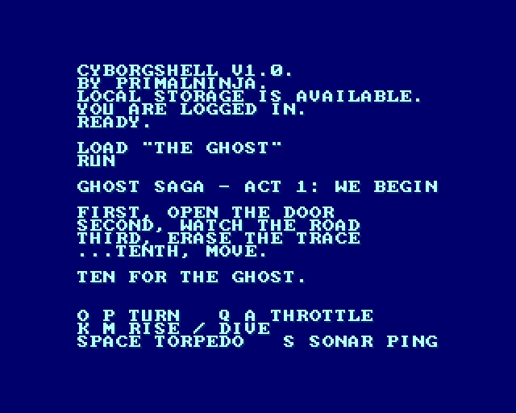
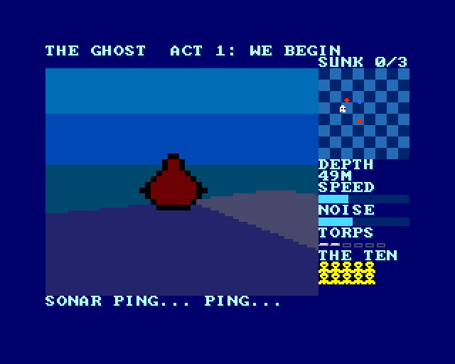
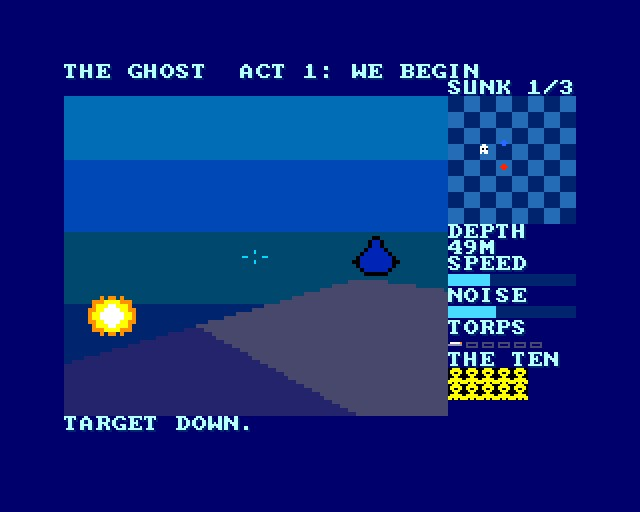
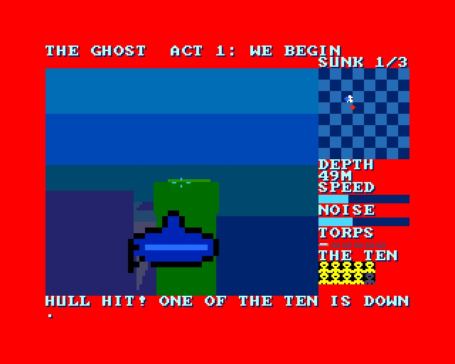
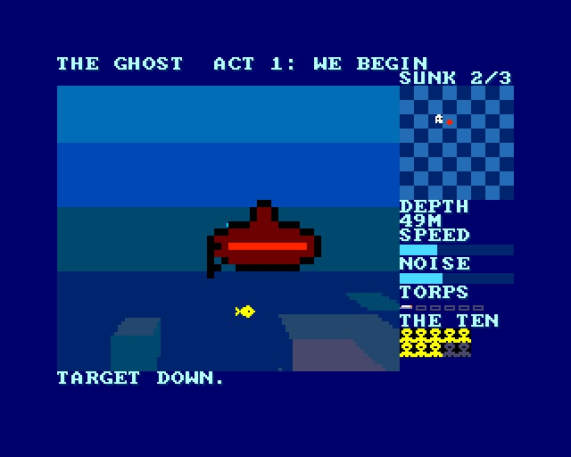
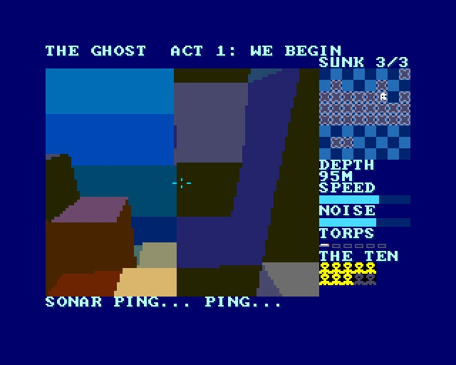

# THE GHOST - Ghost Saga, Act 1: "We begin"

(c) 2026 Cyborg Unicorn Pty Ltd - MIT License

A submarine game for the **ZX Spectrum Next** in **NTC BASIC**. The sea floor is drawn by the
ZX Craft block renderer (filled faces on Layer 2), with murk past 12 blocks. This is the first
playable piece. The rest of the saga can be built on it.

## The story so far

Mr Bad stole the Ghost Sub and took a new name: **The Ghost**. You are him. The Ten are your
crew. They are also your lives: each hit on the hull loses one of them. A Russian and an American
patrol are hunting the boat they lost.

To finish Act 1:
1. Sink all three patrol boats.
2. Take the Ghost Sub to the wreck. The signal is there.

Ten for the Ghost.

## Keys

| | |
|---|---|
| O P | turn left, right |
| Q A | throttle up, down (4 steps) |
| K M | rise, dive |
| Space | torpedo |
| S | sonar ping |
| Kempston | left/right turn, up/down rise/dive, fire torpedo |

## How it plays

- **Noise:** running fast is loud, so the patrol hears you from further off. Slow down to sneak
  up on them.
- **Hunting:** once a boat hears you, it hunts. It turns to face you, matches your depth and goes
  over rock in its way. It fires when it is facing you, close, and has a clear line to you.
- **Sonar ping:** shows every boat on the radar for a while. It also tells them all where you are.
- **Torpedoes:** you have 6 tubes, and they reload slowly. Torpedoes run straight and blow up on
  rock.
- **Radar:** the chessboard on the right is the 16 x 16 map, 2 x 2 blocks a square, at your
  depth. Rock at your depth shows as grey squares.
  - White: you.
  - Red: Russian boats. Blue: American boats. These show when near, or after a ping.
  - Small dots: torpedoes.
  - Flashing marker: the wreck, once the patrol is down.
- **The map:** one 16 x 16 x 16 block sea, with sand, a rock ridge and a tunnel under it, kelp,
  coral, a cable on the bottom, and the wreck.

## Screenshots

Taken in an emulated Next:

## Tested

A scripted pilot played it in the emulator from start to finish: sank all 3 boats, lost 2 of the
Ten, and reached the wreck ("WE BEGIN. THE GHOST IS CALLING."). It then returned to the title.

The game runs at about 12-13 frames a second (emulated Next at 28MHz, no memory wait states).
It hasn't been run on real hardware yet.

## Files

- `Main.bas`: the game.
- `Vox.cls`: the renderer, made by `tools/gen_vox.py`. This is ZX Craft's renderer, changed for
  the Ghost:
  - a 96 x 80 view (192 px wide), leaving the right side free for the radar
  - a 12 block draw distance, with 4 fog colour sets
  - `Project` / `SX` / `SY` / `SZ`, to put sprites in the 3D view
  - `Solid` and `Sight`, for collisions and line of sight
- `World.cls`: the sea floor and its colours, made by `tools/world.py`.
- `GfxData.cls`: tiles and sprites, made from `gfx/` by `gfxtool.js`. Edit the PNGs and
  `layout.txt`, then rebuild.
- `Spr.cls`, `Tiles.cls`, `Sfx.cls`, `Nx.cls`: sprites, tilemap, AY sound, NextRegs.
- `tools/ref.py`: the renderer in Python. The Z80 output matched it pixel for pixel over 275
  moving-camera frames.
- `build.js`, `game.json`, `GHOST.json` (the IDE project).
- `build/`: `GHOST.asm` and `GHOST.NEX`, ready to run.

## Building it

- **IDE:** open `GHOST.json` in NTC BASIC's IDE (`ntc.html`), then **Save .asm** and run
  `sjasmplus GHOST.asm`.
- **Command line:** `node build.js path/to/ntc/src` rebuilds the art, the project, the `.asm` and
  the `.NEX` (when sjasmplus is on the PATH).
- **Running it:** copy `GHOST.NEX` to the SD card and run it from the browser.

## Ideas for the next acts

- **Act 2, The Ghost Bat:** the drone overhead, seen through the periscope at the surface (a flat
  horizon).
- **Act 3, The Ghost Shark:** the mega shark, and a giant octopus.
- More maps, using the chunk form from ZX Craft.
- Each of the Ten given a station, e.g. sonar, torpedoes or engines. Losing her weakens that
  station.
- The real Ghost Shell as the interface between missions.
