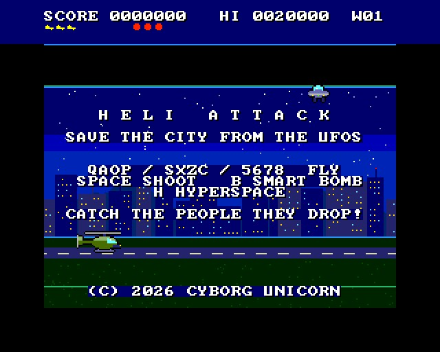
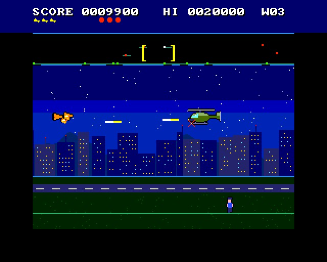
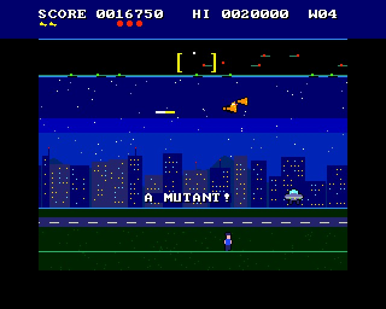
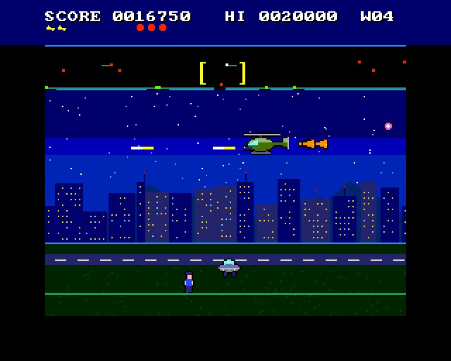

# HELI ATTACK

(c) 2026 Cyborg Unicorn Pty Ltd - MIT License

A Defender for the **ZX Spectrum Next**, with an attack helicopter, written in **NTC BASIC**.

UFOs over the city at night. The city is eight screens long and joins up end to end: fly off one
end and you come back on at the other. The scanner along the top shows all of it, with you in the
middle.

## How it plays

- **Flying:** the helicopter speeds up and slows down; turn round and it faces the other way
  straight away. The view keeps you a third of the way in from the side you're leaving, so you
  can see what's coming.
- **The people:** ten of them, walking about on the ground.
- **The UFOs:**

  | UFO | What it does | Points |
  |---|---|---|
  | Lander | drifts about, comes down for someone and takes them up. Get to the top with them and it's a mutant, and they're gone | 150 |
  | Mutant (green) | straight at you, jittering, shooting pairs | 150 |
  | Bomber | drifts along a wave, laying mines | 250 |
  | Pod | drifts; shoot it and it bursts into 3-5 swarmers | 1000 |
  | Swarmer | small and fast, overshooting, shooting | 150 |
  | Baiter | turns up when a wave takes too long (50 seconds), and more keep coming, keeps up with you, shoots fans | 200 |

- **Saving people:** shoot a lander that's carrying someone and they fall. From low down they
  land safely (250). From higher up they won't survive the fall, unless you catch them (500).
  Fly them down near the ground and they're safe again (another 500).
- **The city lost:** if everyone's gone, every lander turns into a mutant, and new landers come as
  mutants, until the people come back. They come back every fifth wave.
- **A wave:** landers come five at a time (more each wave, up to 25), with bombers from wave 2 and
  pods from wave 3. It ends when every lander, mutant, bomber, pod and swarmer is down. The bonus
  is 100 x the wave for each person still alive.
- **Smart bomb:** everything on the screen goes, and every bullet. 3 per helicopter.
- **Hyperspace:** you vanish and come out somewhere else in the city. One time in four you come
  out in pieces.
- **Lives:** 3. Every 10,000 points is another helicopter and another smart bomb.

## Keys

| | |
|---|---|
| Q A O P, or S X Z C, or 5 6 7 8 (or the joystick) | fly |
| Space or M (fire) | shoot |
| B or Enter (fire 2) | smart bomb |
| H | hyperspace |

## How it works

- **The city** is one Layer 2 picture, 256 pixels wide, that joins up end to end; the hardware
  scrolls it (NextReg #16). Eight times round is the whole city. It's made by `tools/scene.py`.
- **The helicopter** is two sprites (32 x 16), mirrored to face left, its rotors in two frames.
- **The UFOs, the people and the explosions** are sprites. Mutants are landers in another
  palette.
- **The bullets and your tracers** are hardware sprites moved and checked in Z80 (`Bul.cls`, from
  ATTACK OF THE CYBORG UNICORNS 2). They keep flying when they scroll off the screen.
- **The scanner** is the tilemap: each 8 x 8 cell covers 64 pixels of the city, and a dot can be
  in one of 12 places in it. The box on it showing what's on the screen is a sprite.
- **The smart bomb's flash** turns Layer 2's palette offset (NextReg #70) round.

It runs at 50 frames a second in the emulator. It hasn't been run on real hardware yet.

## Files

- `Main.bas`: the game.
- `Scene.cls`: the city. Made by `tools/scene.py`; edit that and run `python3 tools/scene.py`.
- `Bul.cls`: the bullets and tracers.
- `GfxData.cls`: the tiles and sprites. Made from `gfx/` by `gfxtool.js`; the PNGs come from
  `tools/art_helidef.py` (it needs `artkit.py` and `cvkit.py`, which sit beside it).
- `Nx.cls`, `Spr.cls`, `Tiles.cls`, `Sfx.cls`: NextRegs, sprites, the tilemap, AY sound.
- `build.js`, `game.json`, `HELIDEF.json` (the IDE project).
- `build/`: `HELIDEF.asm` and `HELIDEF.NEX`, ready to run.

## Building it

- **IDE:** open `HELIDEF.json` in NTC BASIC's IDE (`ntc.html`), then **Save .asm** and run
  `sjasmplus HELIDEF.asm`.
- **Command line:** `node build.js path/to/ntc/src` rebuilds the art, the project, the `.asm` and
  the `.NEX`.
- **Running it:** copy `HELIDEF.NEX` to the SD card and run it from the browser.

## Screenshots

Taken in an emulated Next:

