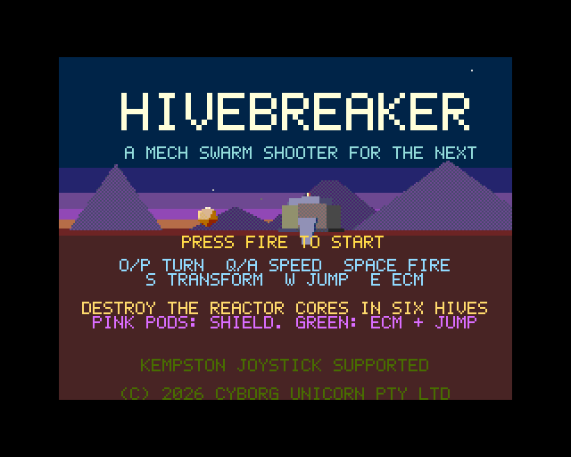
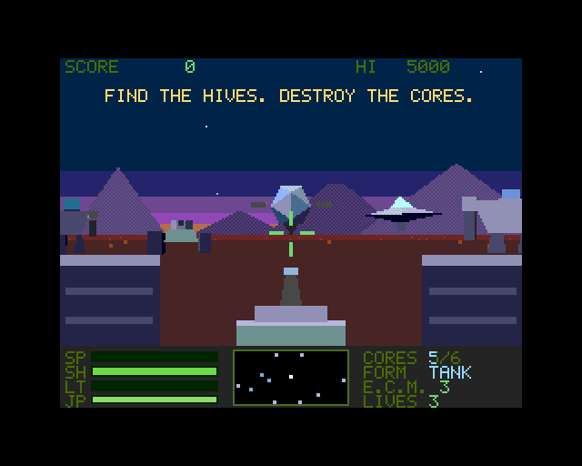
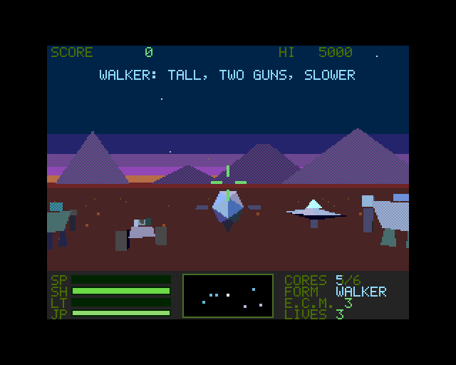
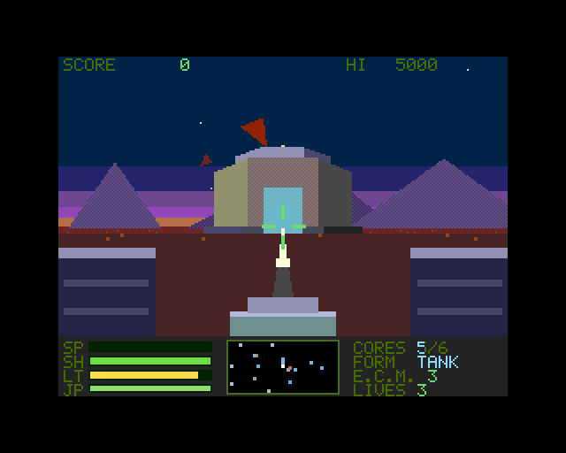
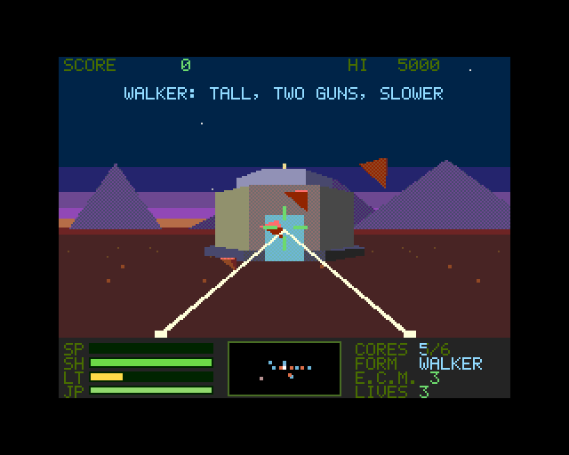
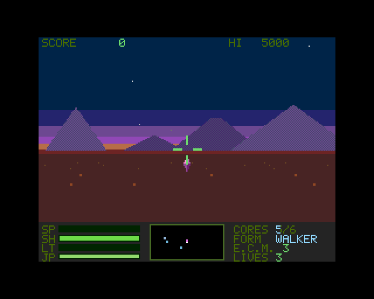
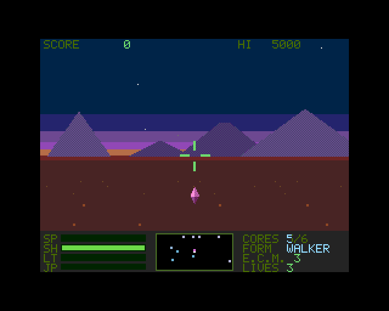
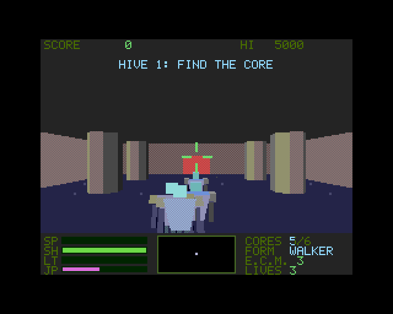
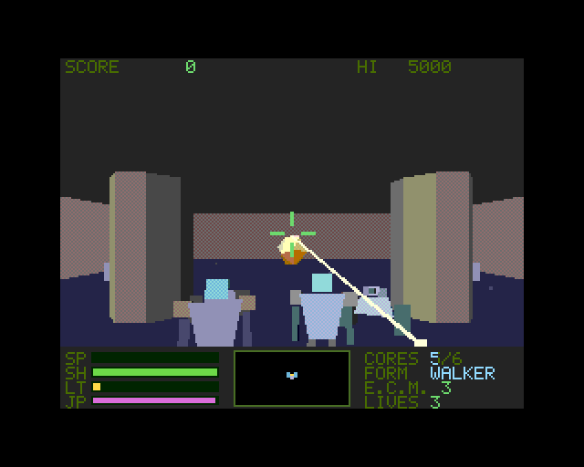

# HIVEBREAKER

(c) 2026 Cyborg Unicorn Pty Ltd - MIT License

*A robot Hive has taken the wasteland. Six reactor cores keep it alive. You are a transforming mech.*

A first-person 3D mech shooter for the **ZX Spectrum Next** (1MB is enough), written in NTC BASIC on
NTC3D. It takes the solid-3D exploring of Cholo and Dark Side and turns it into a Robotron / Berzerk game: a
swarm hunts you across a huge open wasteland, and the hives scattered over it are chains of Berzerk-style
chambers.

  
  
  

## Playing

Colours tell you what's what: **robots are greys and blues, shots are reds and yellows, power-up pods are pink and green.**

You drive a transforming mech. The zone is 92,000 units across; every game places the six hives, the pods and
the scenery differently.

| | TANK | WALKER |
|---|---|---|
| Eye | low (70): you see the tread pods at both sides and the **one turret in the middle** | **tall (280)**: you look down on everything from high above the ground. You see none of the machine |
| Speed | fast (900) | slower (620), turns slower |
| Guns | the turret: slower, hits for 3 | **two guns, low at the sides** (you see their beams, converging on the cross hairs): fire in turn, quick, 1 each |
| Aiming | the guns look along the cross hairs' line; a tall walker's two lines (close and far) let it hit things at its feet as well as far off | |

**S** changes form (the eye and the machine rise or sink over about half a second; no firing while it does).
**W** jumps: a burst up (peak about 460 units: you clear robots, mines and their shots) and then the jump
**has to charge again** (the JP gauge, about 4 seconds) before the next.

- **Outside**, robots come out of the dark all round you, more of them and more kinds for every core you
  destroy. All greys and blues: *grunts* are troopers that run at you and explode on you; *tank-bots* (tracked)
  stand off and shell you; *scouts* (flying saucers) strafe round you and shoot; from two cores *orbs* (hovering
  spheres with fins) circle and fire, and *hulks* (big grey brutes, six hits) lumber in. Blue crystal *mines* go
  off when you touch them (or shoot them). Now and then a kill leaves a **pod**: **pink** = shield +35,
  **green** = E.C.M. +1 and a charged jump (and cooled guns). Six pods lie about the zone from the start.
- **Hives**: the scanner's edge blips point to every hive still standing. Drive into the glowing cyan door on a
  hive's south side. Inside are three chambers: troopers (they walk at you and shoot red shots), tank-bots, turrets in the
  corners, pillars. The door ahead is red until the chamber is clear, then green. The third chamber holds the
  **reactor core** (12 hits). Destroy it and you have a few seconds to get out before the hive goes: +2500 and +30 shield.
- **The Warden** is indestructible and fast. If you stay in a chamber for about 45 seconds it comes for you.
- Destroy all six cores to win (bonus: shields x10, pods x200). Three lives; a death repairs you where you are.

### Controls (the Spectrum's usual: left hand Q A W S E, right hand O P Space)

| | |
|---|---|
| O / P | turn left / right |
| Q / A | throttle up / down. It **holds** your speed, as Elite's does |
| Space or Enter | fire (the guns overheat: see LT) |
| S | transform: tank <-> walker |
| W | jump (then it recharges) |
| E | E.C.M.: wipes every robot shot, and hurts everything in sight (3 to start) |
| Kempston joystick | left / right turn, up / down throttle, fire, fire 2 = jump |

The bottom panel: **SP** speed, **SH** shield, **LT** gun temperature, **JP** jump charge, the Elite-style scanner
(NTC3D's `Radar3D`: you in the middle, ahead is up, each thing a dot on a stalk showing how high it is: robots
blue and grey, shots red, pods pink and green; hives out of range are blips on its edge), and CORES, FORM,
E.C.M. and LIVES. The ground is dots, going by as you go.

## Building

```
node build.js [path to NTC's src folder]     # needs node; sjasmplus on the PATH (or SJASMPLUS=...) for the NEX
```

NTC's `src` folder (the one with `ntc3d/` in it) is taken from the argument, then `NTC_SRC`, then `../../..`:
HIVEBREAKER can sit in `src/ntc3d/example/` next to ROCKS, or anywhere else when `src` is given (it sets
`game.json`'s `framework` to NTC3D's folder). Nothing of NTC is copied here. Built against NTC `ntc_21e8e2`.

It runs NTC3D's model tool (`models.js` -> `E3Data.cls`, `build/HIVEBRK.DAT`, `models.png`), then its build
tool: the IDE project `HIVEBRK.json`, `build/HIVEBRK.asm` and `build/HIVEBRK.NEX`. `build/` is in the zip: the
NEX is ready to copy to the Next's SD card (`HIVEBRK.sym` is for the tests). The NEX ends at `#BD46`: under 200 bytes of
program memory left (the polygon filler's alignment makes it vary). It runs on a 1MB Next.

## How it's made

- **NTC3D**: the 3D engine, objects with movers, hits, drawing, HUD, and `Radar3D`'s scanner (all NTC's own, unchanged).
- **`DriveTank`** (`Main.bas`): the mech's driving: Elite's throttle (kept, never reversing), the turn, the
  transform (the eye's height, the speeds), the jump (a burst and gravity, a charge), and the phases the
  drawing needs.
- **`DrawMech`**: the tank's treads and turret are drawn in 2D over the picture (boxes and a polygon) and slide
  below the panel as you rise to a walker, whose guns are only beams from low at the sides. **`DrawDots`**: the ground's dots: rows of dots going by,
  seen from your eye's height (`y = 96 + eye x 128 / distance`); the rows are always square to your heading
  and turning sweeps them sideways (a drawing trick: far cheaper than dots placed in the world).
- **Guns are hitscan** (`Obj3D.Pick`, its line raised or lowered with your eye's height): at 4 ticks a
  picture a moving bolt steps over a hit box in one go; Pick doesn't care about frame rate. The beams are
  cosmetic. Only the robots' shots are objects.
- **`models.js`**: 20 solid kinds and a 16 ramp palette: blues and greys for robots, reds and yellows for
  shots and fire, pink and green for pods. The robots are compounds of tapered blocks (`tp`): legs with feet,
  a V chest, a visor, shoulder pads; far away (the engine swaps models by distance) they're a tapered
  silhouette. 15.6K of the data block's 16.4K. Robots keep their eye as their head's front face so a compound
  needs one painter's order, not two.
- **`Main.bas`** also: streaming the 36 world sites in and out as you go (positions kept in whole cells;
  `Fly3D.Rebase` keeps the 16 bit world near the middle), the swarm spawner, the chambers (walls are `Quad3`
  faces), the hits, the HUD and the screens.
- **`Sfx.cls`**: AY sound effects, from LITTLE SEOUL / DEMON SEOUL.

## Testing

`test/hb_*.py` run the game in NTC3D's Next emulator (NTC's `ntc3d/tools/emu`, found from `NTC_SRC` (or
`NTC3D_EMU=`, or `../../../tools/emu`); `pip install z80 pillow`; build first): `hb_smoke` (boot, start,
drive), `hb_mech` (tank, transform, walker, the jump and its recharge), `hb_flow` (the whole loop: to a hive, in
by its door, three chambers, the core, out again), `hb_robots` (one of each robot, as a tank and as a walker), `hb_enemies` (the swarm, E.C.M., a pod, a mine), `hb_screens`
(dying, game over, the Warden, the victory screen), `hb_speed` (frames a picture), `hb_shots` (these pictures).
The tests poke `dbg` (1 near hive 0, 2 into it, 3 god mode, 4 next chamber, 5 core nearly dead, 6 the Warden,
7 five cores gone, 8 / 11 a green / pink pod ahead, 9 a mine, 12 one of each robot ahead) in the game.

## Where it stands

- About **3.9 - 4.2 frames a picture** (12 - 13 pictures a second) in the emulator.
- Collisions with scenery are sticky (you stop against a pillar, you don't slide along it); robots walk
  through hives and are shoved back out of pillars, not steered round.
- Program memory is nearly full: more features need a trim first. No music; no high score saved; not yet tried
  on real hardware.

(c) 2026 Cyborg Unicorn Pty Ltd - MIT License. Built on NTC3D.
