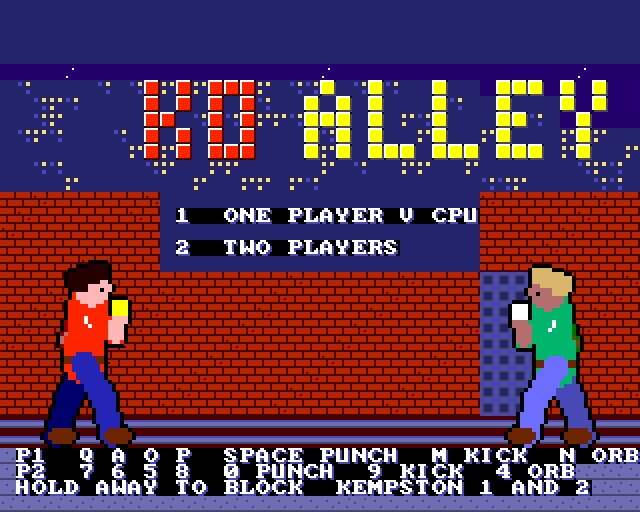
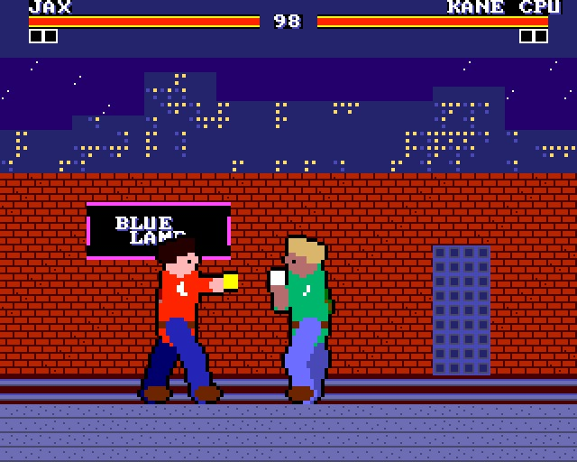
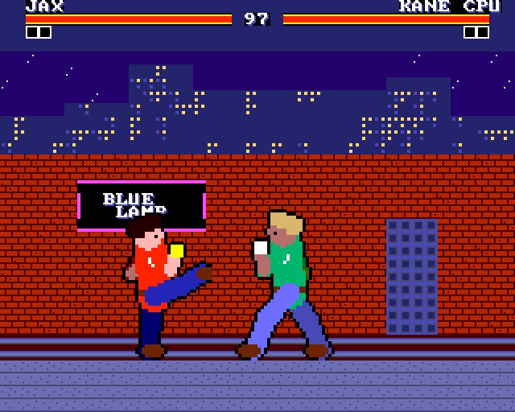
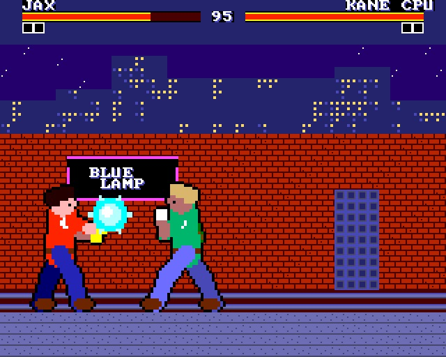

# KO ALLEY - one on one street fighting

(c) 2026 Cyborg Unicorn Pty Ltd - MIT License

A game for the **ZX Spectrum Next**, written in **NTC BASIC** (VB5 flavour) and talking straight to the hardware: tilemap, sprites, Layer 2 and the AY are all driven directly. It makes a `.NEX` file.

Two brawlers, JAX and KANE, fight in a back alley: best of three rounds, 99 seconds a round.
You have a punch, a high kick, a low sweep, a jump kick, blocking and a thrown energy orb. Hold
away from your opponent to block. Crouch-block the sweep and stand-block the jump kick. Two orbs
that meet cancel each other out. Play the computer or a friend.

## Keys

| | Player 1 (JAX) | Player 2 (KANE) |
|---|---|---|
| jump / crouch / left / right | Q A O P | 7 6 5 8 |
| punch | Space | 0 |
| kick (with crouch: sweep) | M | 9 |
| energy orb | N | 4 |
| joystick | Kempston 1: fire punches, fire 2 kicks, fire while crouching throws the orb | Kempston 2 |

On the title screen, 1 picks one player against the computer and 2 picks two players. The
computer gets keener on blocking each round.

## How it uses the hardware

- **Sprites:** each fighter is six hardware sprites (2 x 3 cells), drawn 32 x 48 and shown at
  2x scale (64 x 96). They are mirrored to face left by swapping the columns and setting each
  sprite's mirror bit. The second fighter and the hit flash are sprite palette rows over the
  same 84 patterns. The orbs and hit sparks are scaled sprites too.
- **Tilemap:** the alley (sky, skyline, brick wall, doorway, neon sign, pavement), the health
  bars (cells filled 0-8 pixels, from the left for player 1 and from the right for player 2),
  the round markers, the clock and the messages.
- **AY:** swings, hits, blocks, orbs and the knockout.
- Runs at a full 50 frames a second.

## Files

`Main.bas`, `Nx.cls`, `Spr.cls`, `Tiles.cls`, `Sfx.cls`, `GfxData.cls`. Also `gfx/` (the art and its layout), `gfxtool.js` (art to `GfxData.cls`), `build.js` (the whole build), `game.json` (the file list for build.js), `KOALLEY.json` (the IDE project) and `build/` (`KOALLEY.asm` and `KOALLEY.NEX`, ready to run).

## Building it

Everything is plain NTC BASIC, VB5 flavour, platform `zxn`. The BASIC compiler and library are
NTC's own, unchanged. The game only brings its own classes.

**In the IDE (`ntc.html`):** use **Open...** to load `KOALLEY.json`. It brings in every file, with
the platform set to ZX Spectrum Next and the mode set to turbo. Then **Save .asm** and run
`sjasmplus KOALLEY.asm`, which writes `KOALLEY.NEX`.

**From the command line:** `node build.js path/to/ntc/src` does the lot. It rebuilds `GfxData.cls`
from `gfx/`, writes `KOALLEY.json`, compiles to `build/KOALLEY.asm`, and assembles `build/KOALLEY.NEX`
if sjasmplus is on the PATH. If you drop the game folder into `src/bas/`, you can leave the path
off.

`build/` already holds a built `KOALLEY.asm` and `KOALLEY.NEX`.

**Running it:** copy `KOALLEY.NEX` to the Next's SD card and pick it in the NextZXOS browser. It
takes over the whole machine: no ROM, no OS, 28MHz. To leave, reset.

## Swapping the graphics

All the art lives in `gfx/` as PNG files. The game never refers to a cell by its number. It uses
the names in `gfx/layout.txt` (`GfxData.S_PLAYER`, `GfxData.T_WALL` ...), so new art drops in
without touching the BASIC.

1. Edit the PNGs, or draw new ones the same size:
   - `tile_pal.png`: 16 x 1 pixels, the tilemap's 16 colours. Colour 15 is see-through.
   - `tiles.png`: 128 pixels wide, 8 x 8 cells, 16 to a row. Cell n is tile n. Cells 32-126 are
     the font, because Print and Tiles.Text use the character code as the tile number.
   - `spr_pal.png`: 16 x N pixels. Row 0 holds the sprite colours the sheet is drawn in. Rows
     1 and up are other colourings of the same 16 slots, which the game picks with a palette
     offset.
   - `sprites.png`: 256 pixels wide, 16 x 16 cells, 4 bit (15 colours plus see-through).
   - Magenta (#FF00FF) or see-through pixels come out transparent. Any other colour is matched
     to the nearest palette entry.
2. If you move things around, change `layout.txt` to match. A sprite entry is
   `sprite NAME col row [frames [w h]]`, a tile entry is `tile NAME index [count]`.
3. Run `node gfxtool.js build`, or `node build.js`, which runs it for you. That rewrites
   `GfxData.cls`. In the IDE, open the new `GfxData.cls` in place of the old one, or open the
   new `KOALLEY.json`.

`node gfxtool.js info` lists what the sheets hold. `node gfxtool.js grid` writes
`gfx/*_grid.png`: the sheets blown up 4x with the cell grid drawn on and the named cells boxed.
It's a guide for drawing over; gfxtool doesn't read those files back.

The Next holds at most 128 four-bit sprite patterns and 256 tiles, and gfxtool stops with an
error if the layout asks for more.

## The hardware classes

These are shared by all five games. Every method is an `#asm` keyword or a few lines of BASIC.
No Z80N opcodes are used except in SOLAR's View.cls, so any Z80 assembler builds them.

| Class | What it does on the Next |
|---|---|
| `Nx.cls` | NextRegs through `#243B`/`#253B`, the layer order (`#15`), palettes (`#40`/`#41`/`#43`), raster line, border, `Seed` |
| `Spr.cls` | 128 hardware sprites: a table of 5-byte attributes in RAM, sent by `Show` through `#303B`/`#57` straight after `Frame`; 4-bit patterns, mirror, rotate, scale 1x-8x, palette offset |
| `Tiles.cls` | The tilemap as a 40 x 32 4-bit picture over the whole 320 x 256 display. The map stays at bank 5 + `#2000` so `Print`/`Locate` still work; tile definitions sit at bank 5 + `#0000` (`#C000`), which means the ULA is switched off |
| `Sfx.cls` | AY 1 through `#FFFD`/`#BFFD`: three channels of sliding-pitch, fading tone or noise effects, updated once a frame |
| `GfxData.cls` | Made by gfxtool.js: the palettes, tile definitions and sprite patterns as data, plus `Load` to put them into the hardware |

Every game runs in turbo mode (`Option Turbo`): interrupts stay off and `Frame` times each frame
by reading the raster line (NextRegs `#1E`/`#1F`).

## Memory

The program, its arrays and the graphics data sit in RAM pages 16-21 at `#0040-#BDFF`, with the
stack at `#BE00-#BFFF`, laid out the same as the CPC (the zxn platform). Bank 5 is at
`#C000-#FFFF`: tile definitions at `#C000-#DFFF` and the tilemap at `#E000`.

The font is font8x8_basic (public domain), the same as the zxn platform uses. All the art is original.

## Screenshots

Taken in an emulated Next (320 x 256, shown at 2x), in `screenshots/`:

