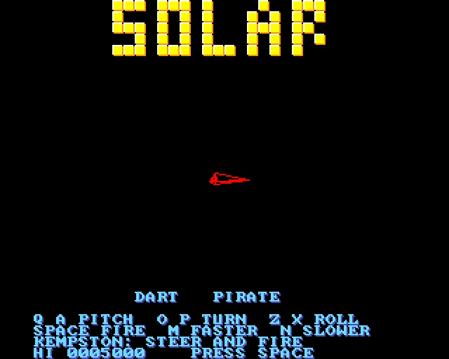
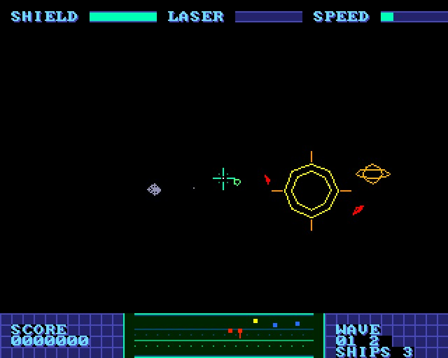
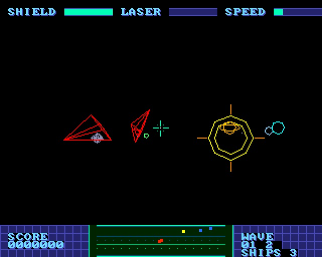
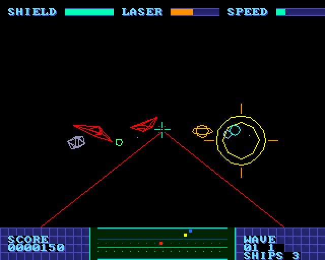

# SOLAR - a 3D vector shooter in a small solar system

(c) 2026 Cyborg Unicorn Pty Ltd - MIT License

A game for the **ZX Spectrum Next**, written in **NTC BASIC** (VB5 flavour) and talking straight to the hardware: tilemap, sprites, Layer 2 and the AY are all driven directly. It makes a `.NEX` file.

Pirates have come to the Kestrel system: a yellow sun, four planets going round it (a rock
world, an ocean world, a ringed giant and an ice world) and a ring of tumbling rocks. Fly your
fighter in full 3D and shoot the pirates down, wave after wave. Darts, Hornets and Mantises
each take more hits. They line up on you and fire. The sun burns your shields if you get too
close, flying into anything is fatal, and the edge of the system turns you back. You have three
ships, and your shields recharge a little between waves.

## Keys

| | |
|---|---|
| Q / A | pitch (nose down / up) |
| O / P | turn left / right |
| Z / X | roll |
| Space | fire (the lasers heat up: watch the LASER bar) |
| M / N | faster / slower |
| Kempston joystick | pitch and turn, fire |

The scanner at the bottom shows what is around you, seen from above with ahead at the top: red
for pirates (with a tick when they are above or below you), blue for planets, yellow for the
sun.

## How it uses the hardware

- **View.cls**, the 3D engine (all Z80): a camera with a right/up/forward basis in 2.14 fixed
  point, turned in 2-degree steps and kept square, as CITY3D does. It projects points, builds
  wireframe models from a combined camera x model matrix, cuts lines that pass the camera at
  the near plane, and makes ellipses for the planets. Everything goes into a table of lines that
  `L2.Lines` draws in a single call.
- **The Next's hardware multiplier:** View.cls multiplies with the Z80N's `MUL D,E` (8 T states
  for 8 x 8 bits; four of them make a 16 x 16 product). It is written as `db #ED, #30`, so
  sjasmplus doesn't need `--zxnext`. It doubled the frame rate over shift-and-add.
  It is the only Z80N instruction in any of the games.
- **Layer 2** (`L2.cls`): two buffers, lines erased by redrawing, as in NEON WAR.
- **Tilemap:** the panels, the bars, the scanner and its grid, and the messages. They sit in the
  border rows above and below Layer 2. A palette change flashes the panels red when you are hit.
- **Sprites:** the sights and the scanner's blips.
- **AY:** lasers, hits, explosions and warnings.
- About 15-25 frames a second, depending on what is in view. Far-off ships and rocks are drawn
  as dots, and small planets with fewer lines.

World coordinates are 16-bit integers. The system is kept within +-9000 on each axis, so the
distance between any two things fits.

## Files

`Main.bas`, `Nx.cls`, `Spr.cls`, `Tiles.cls`, `Sfx.cls`, `L2.cls`, `View.cls`, `Models.cls` (the ship and rock wireframes, and a sine table), `GfxData.cls`. Also `gfx/` (the art and its layout), `gfxtool.js` (art to `GfxData.cls`), `build.js` (the whole build), `game.json` (the file list for build.js), `SOLAR.json` (the IDE project) and `build/` (`SOLAR.asm` and `SOLAR.NEX`, ready to run).

## Building it

Everything is plain NTC BASIC, VB5 flavour, platform `zxn`. The BASIC compiler and library are
NTC's own, unchanged. The game only brings its own classes.

**In the IDE (`ntc.html`):** use **Open...** to load `SOLAR.json`. It brings in every file, with
the platform set to ZX Spectrum Next and the mode set to turbo. Then **Save .asm** and run
`sjasmplus SOLAR.asm`, which writes `SOLAR.NEX`.

**From the command line:** `node build.js path/to/ntc/src` does the lot. It rebuilds `GfxData.cls`
from `gfx/`, writes `SOLAR.json`, compiles to `build/SOLAR.asm`, and assembles `build/SOLAR.NEX`
if sjasmplus is on the PATH. If you drop the game folder into `src/bas/`, you can leave the path
off.

`build/` already holds a built `SOLAR.asm` and `SOLAR.NEX`.

**Running it:** copy `SOLAR.NEX` to the Next's SD card and pick it in the NextZXOS browser. It
takes over the whole machine: no ROM, no OS, 28MHz. To leave, reset.

## Swapping the graphics

All the art lives in `gfx/` as PNG files. The game never refers to a cell by its number. It uses
the names in `gfx/layout.txt` (`GfxData.S_PLAYER`, `GfxData.T_WALL` ...), so new art drops in
without touching the BASIC.

1. Edit the PNGs, or draw new ones the same size:
   - `tile_pal.png`: 16 x 1 pixels, the tilemap's 16 colours. Colour 15 is see-through.
   - `tiles.png`: 128 pixels wide, 8 x 8 cells, 16 to a row. Cell n is tile n. Cells 32-126 are
     the font, because Print and Tiles.Text use the character code as the tile number.
   - `spr_pal.png`: 16 x N pixels. Row 0 holds the sprite colours the sheet is drawn in. Rows
     1 and up are other colourings of the same 16 slots, which the game picks with a palette
     offset.
   - `sprites.png`: 256 pixels wide, 16 x 16 cells, 4 bit (15 colours plus see-through).
   - Magenta (#FF00FF) or see-through pixels come out transparent. Any other colour is matched
     to the nearest palette entry.
2. If you move things around, change `layout.txt` to match. A sprite entry is
   `sprite NAME col row [frames [w h]]`, a tile entry is `tile NAME index [count]`.
3. Run `node gfxtool.js build`, or `node build.js`, which runs it for you. That rewrites
   `GfxData.cls`. In the IDE, open the new `GfxData.cls` in place of the old one, or open the
   new `SOLAR.json`.

`node gfxtool.js info` lists what the sheets hold. `node gfxtool.js grid` writes
`gfx/*_grid.png`: the sheets blown up 4x with the cell grid drawn on and the named cells boxed.
It's a guide for drawing over; gfxtool doesn't read those files back.

The Next holds at most 128 four-bit sprite patterns and 256 tiles, and gfxtool stops with an
error if the layout asks for more.

## The hardware classes

These are shared by all five games. Every method is an `#asm` keyword or a few lines of BASIC.
No Z80N opcodes are used except in SOLAR's View.cls, so any Z80 assembler builds them.

| Class | What it does on the Next |
|---|---|
| `Nx.cls` | NextRegs through `#243B`/`#253B`, the layer order (`#15`), palettes (`#40`/`#41`/`#43`), raster line, border, `Seed` |
| `Spr.cls` | 128 hardware sprites: a table of 5-byte attributes in RAM, sent by `Show` through `#303B`/`#57` straight after `Frame`; 4-bit patterns, mirror, rotate, scale 1x-8x, palette offset |
| `Tiles.cls` | The tilemap as a 40 x 32 4-bit picture over the whole 320 x 256 display. The map stays at bank 5 + `#2000` so `Print`/`Locate` still work; tile definitions sit at bank 5 + `#0000` (`#C000`), which means the ULA is switched off |
| `Sfx.cls` | AY 1 through `#FFFD`/`#BFFD`: three channels of sliding-pitch, fading tone or noise effects, updated once a frame |
| `GfxData.cls` | Made by gfxtool.js: the palettes, tile definitions and sprite patterns as data, plus `Load` to put them into the hardware |

Every game runs in turbo mode (`Option Turbo`): interrupts stay off and `Frame` times each frame
by reading the raster line (NextRegs `#1E`/`#1F`).

## Memory

The program, its arrays and the graphics data sit in RAM pages 16-21 at `#0040-#BDFF`, with the
stack at `#BE00-#BFFF`, laid out the same as the CPC (the zxn platform). Bank 5 is at
`#C000-#FFFF`: tile definitions at `#C000-#DFFF` and the tilemap at `#E000`.
Layer 2 uses banks 16-21 (pages 32-43), which it maps into slot 6 only while drawing.

The font is font8x8_basic (public domain), the same as the zxn platform uses. All the art is original.

## Screenshots

Taken in an emulated Next (320 x 256, shown at 2x), in `screenshots/`:

