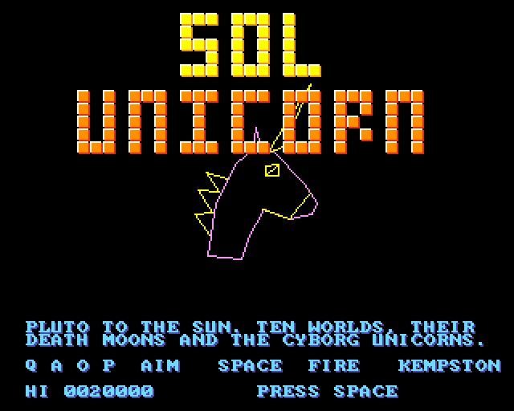
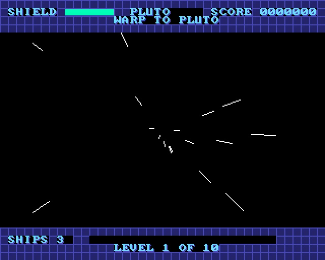
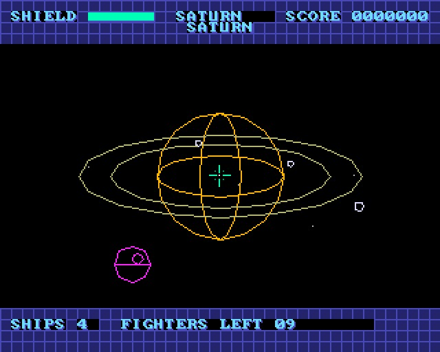
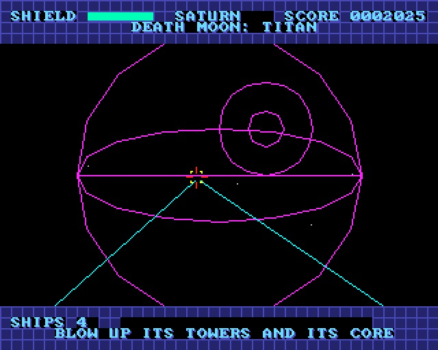
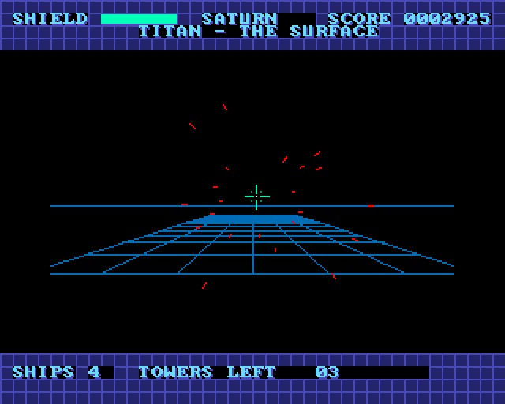
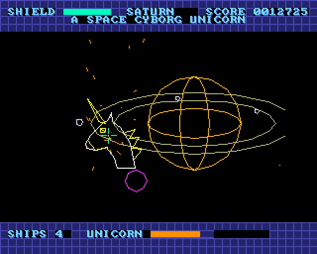
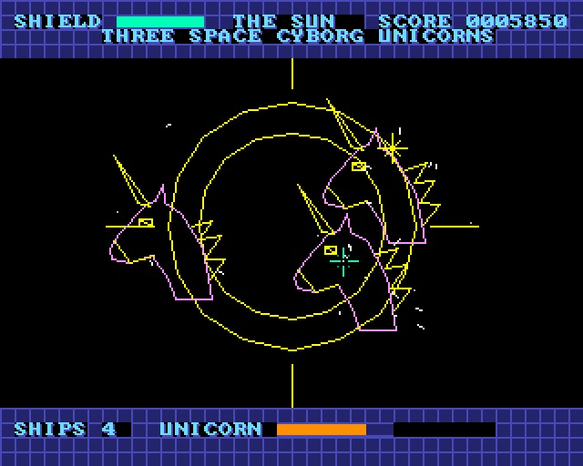

# SOL UNICORN - Pluto to the Sun

(c) 2026 Cyborg Unicorn Pty Ltd - MIT License

A 3D vector space shooter for the **ZX Spectrum Next**, written in **NTC BASIC** (VB5 flavour) and
talking straight to the hardware: Layer 2, tilemap, sprites and the AY, with no ROM calls. It plays
like 3D Starstrike or the Star Wars arcade game: you aim the sights and the ship turns towards them.

The Space Cyborg Unicorns have taken the solar system. Start at Pluto and fight your way in, one
world a level, warping between them:

| Level | World | Its moons (the death moon in capitals) |
|---|---|---|
| 1 | Pluto | CHARON, Nix, Hydra |
| 2 | Neptune (thin ring) | Proteus, TRITON, Nereid |
| 3 | Uranus (thin ring) | Miranda, Ariel, Umbriel, TITANIA, Oberon |
| 4 | Saturn (the rings) | Tethys, Dione, Rhea, TITAN, Iapetus |
| 5 | Jupiter (thin ring) | Io, EUROPA, Ganymede, Callisto |
| 6 | Mars | PHOBOS, Deimos |
| 7 | Earth | the MOON |
| 8 | Venus | no moons: the unicorns built a STATION |
| 9 | Mercury | no moons: a STATION |
| 10 | The Sun | three Space Cyborg Unicorns at once |

Each level runs in this order:

1. **Warp:** a starfield streaks past and the world's name comes up.
2. **Fighters:** Shard fighters weave in and fire bolts at you. You can shoot the bolts down too.
   An edge marker points to the next fighter when it's off screen.
3. **The death moon:** fly in at it (dish, trench and all), then skim its surface. Blast its
   towers, which also fire at you, then hit the core before it goes past. Miss it and you go
   round again.
4. **The Space Cyborg Unicorn:** it comes out of the wreck, circles and fires from its horn.
   Its health is on the bottom bar.
5. Win and you get an extra ship (up to 5), then warp to the next world.

At the Sun you fight more fighters, then all three unicorns together. Beat them and the solar
system is free. Your shield takes the hits; when it runs out you lose a ship and the shield
comes back full. You start with 3 ships.

## Keys

| | |
|---|---|
| Q A O P | move the sights up, down, left, right (near the edge, the ship turns) |
| Space | fire |
| Kempston joystick | the sights, fire |

## How it uses the hardware

- **View.cls**, the 3D engine (all Z80, shared with SOLAR): a camera basis in 2.14 fixed point,
  projection, wireframe models with lines cut at the near plane, and ellipses for the worlds,
  moons and rings. The sums use the Next's own `MUL D,E` (Z80N, written as `db #ED,#30`). Model
  points use two of them for a byte x word multiply, and 16 x 16 products use four.
- **Layer 2** (`L2.cls`): 256 x 192 with two buffers. Lines are erased by drawing them again, and
  `Lines` draws a whole table in one call.
- **Tilemap:** the panels above and below Layer 2 (shield, world, score, ships, what's left to do,
  the bars) and the title. The panels flash through a palette change when you are hit or a moon
  blows.
- **Sprites:** the sights (they go red as you fire) and the edge marker.
- **AY:** lasers, bolts, explosions, the warp and the unicorns.
- **Models.cls:** the Shard fighter, tower, core, surface grid, and the unicorn (its head
  outline, plus its horn, cyborg eye, mane and jaw plate as a second model in another colour),
  along with a sine table.
- **Speed:** 25 frames a second in most of the game, about 12 against one unicorn, and about 10
  against the three at the Sun.

## Files

`Main.bas` (the game), `Nx.cls`, `Spr.cls`, `Tiles.cls`, `Sfx.cls`, `L2.cls`, `View.cls`,
`Models.cls`, `GfxData.cls`. Also `gfx/` (the tiles and sprites, and their layout), `gfxtool.js`,
`build.js`, `game.json`, `SOLUNI.json` (the IDE project), `build/` (`SOLUNI.asm` and `SOLUNI.NEX`,
ready to run) and `screenshots/`.

## Building it

- **IDE:** open `SOLUNI.json` in NTC BASIC's IDE (`ntc.html`). It sets the platform to ZX
  Spectrum Next and turbo mode. Then **Save .asm** and run `sjasmplus SOLUNI.asm`.
- **Command line:** `node build.js path/to/ntc/src` remakes `GfxData.cls`, the project, the `.asm`
  and the `.NEX` (when sjasmplus is on the PATH).
- **Running it:** copy `SOLUNI.NEX` to the SD card and run it from the browser.

## Swapping the graphics

The panels, font, bars and sprites come from the PNGs in `gfx/`, named in `gfx/layout.txt`. To
change them, edit the PNGs and run `node gfxtool.js build`, or `node build.js`. The rules are the
same as the other games: 16-colour palettes, colour 15 is see-through, tiles are 8 x 8 and
sprites 16 x 16. The 3D models are data in `Models.cls`: each is a count of points (x, y, z in
4s of world units, z forward), then a count of lines (point pairs).

## Memory

The program and its data sit at `#0040-#BDFF` (RAM pages 16-21) with the stack at
`#BE00-#BFFF`. Bank 5 is at `#C000`: tiles at `#C000-#DFFF` and the tilemap at `#E000`.
Layer 2 is banks 16-21, which it maps into slot 6 only while drawing.

## Screenshots

Taken in an emulated Next:

