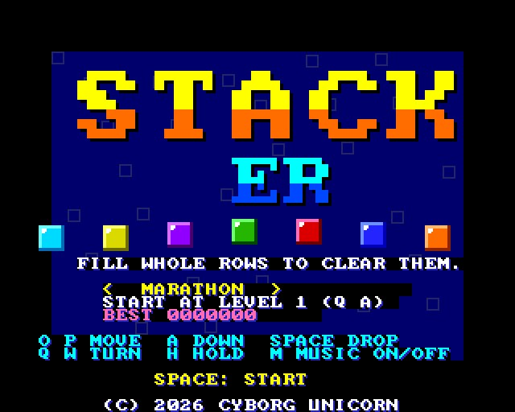
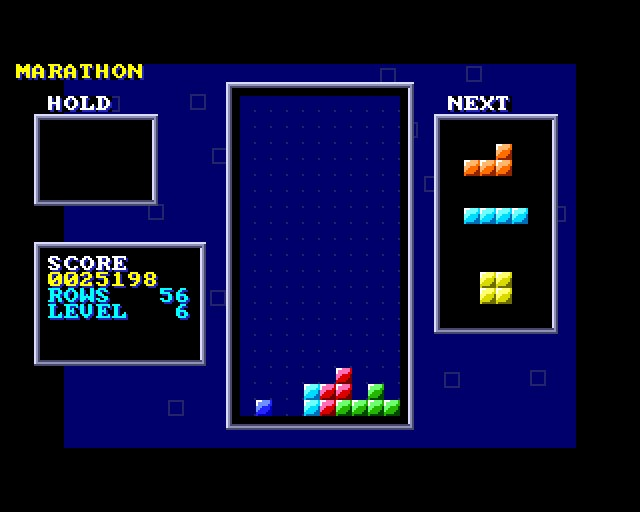
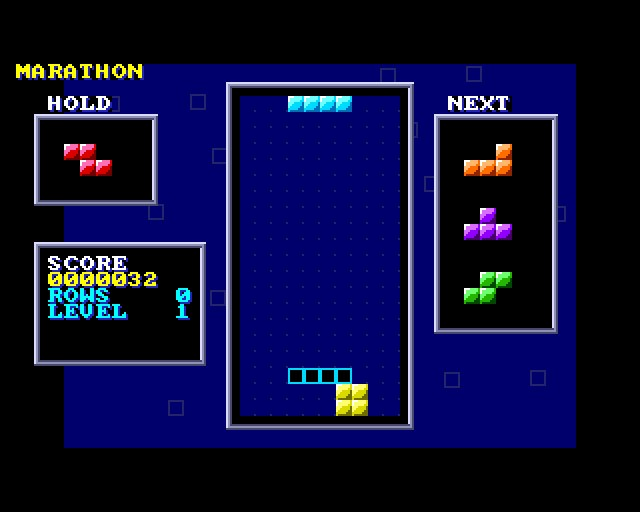
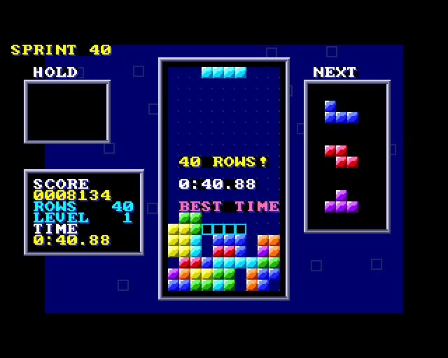

# STACKER

(c) 2026 Cyborg Unicorn Pty Ltd - MIT License

A falling block puzzle for the **ZX Spectrum Next**, written in **NTC BASIC**. The seven
four-block pieces fall into a well ten wide and twenty deep. Turn them and slide them so they
fill whole rows: a full row goes.

## Two games

- **MARATHON:** the level goes up every ten rows and the pieces fall faster each level (start
  at any level from 1 to 15). It goes on until the well's full.
- **SPRINT:** forty rows as quick as you can, against the clock. The best time is kept (until
  the Next's switched off).

## How it plays

- **The pieces** come out of a bag of all seven, shuffled, then another bag: you never wait long
  for any piece.
- **NEXT** shows the next three. **HOLD** puts the piece away for later (or swaps it with the
  one there), once per piece.
- **The ghost** (an outline at the bottom) shows where the piece will land.
- **Turning** nudges the piece left, right or up a cell if it won't fit where it is (two cells
  for the long piece), so it turns against walls and other blocks.
- **Landing:** a piece that's landed can still be slid or turned for half a second before it
  sets (moving it puts that off, up to 15 times). Space drops it straight down and sets it.
- **Scoring:** 1 row 100, 2 rows 300, 3 rows 500, 4 rows 800, times the level; 1 a row for
  holding A down, 2 a row for dropping.
- **The music** is an old Russian folk tune (Korobeiniki). M turns it off and on.

## Keys

| | |
|---|---|
| O / P | left / right (hold: keeps going) |
| A | down faster |
| Space | drop |
| Q / W | turn right / left |
| H | hold |
| M | music on / off |
| joystick | left / right / down, up turns, fire drops |
| on the title | O P choose the game, Q A the starting level, Space start |

## How it works

- **The well, the panels and the words** are the tilemap, two bytes a cell: every block is the
  same tile in one of seven palette rows (one for each piece's colour), with an eighth for the
  white flash when rows go and a ninth grey for the end.
- **The picture behind** is Layer 2.
- **The pieces** are four cells each in each of four turns, kept as strings of digits.
- **The music** plays a note at a time on the AY's first channel; the sounds use the other two.

It runs in the emulator at 50 frames a second. It hasn't been run on real hardware yet.

## Files

- `Main.bas`: the game.
- `Board.cls`: the tilemap with a palette row per cell.
- `L2.cls`: Layer 2 (the backdrop, the title's big letters).
- `GfxData.cls`: the tiles and sprites. Made from `gfx/` by `gfxtool.js`; the PNGs come from
  `tools/art_stacker.py` (it needs `artkit.py` and `cvkit.py`, which sit beside it).
- `Nx.cls`, `Spr.cls`, `Tiles.cls`, `Sfx.cls`: NextRegs, sprites, the tilemap, AY sound.
- `build.js`, `game.json`, `STACKER.json` (the IDE project).
- `build/`: `STACKER.asm` and `STACKER.NEX`, ready to run.

## Building it

- **IDE:** open `STACKER.json` in NTC BASIC's IDE (`ntc.html`), then **Save .asm** and run
  `sjasmplus STACKER.asm`.
- **Command line:** `node build.js path/to/ntc/src` rebuilds the art, the project, the `.asm` and
  the `.NEX`.
- **Running it:** copy `STACKER.NEX` to the SD card and run it from the browser.

## Screenshots

Taken in an emulated Next:

